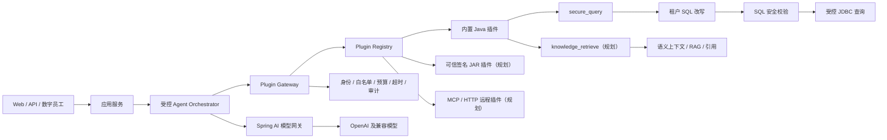
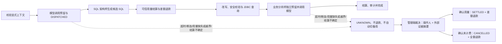
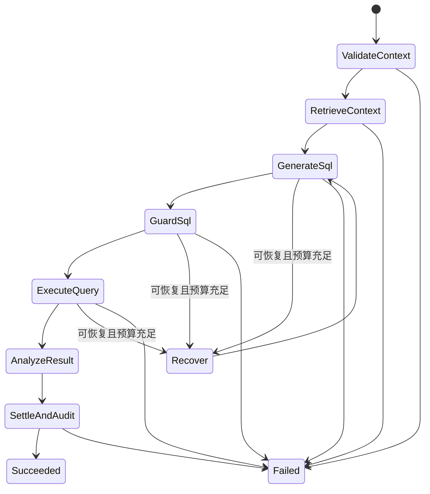
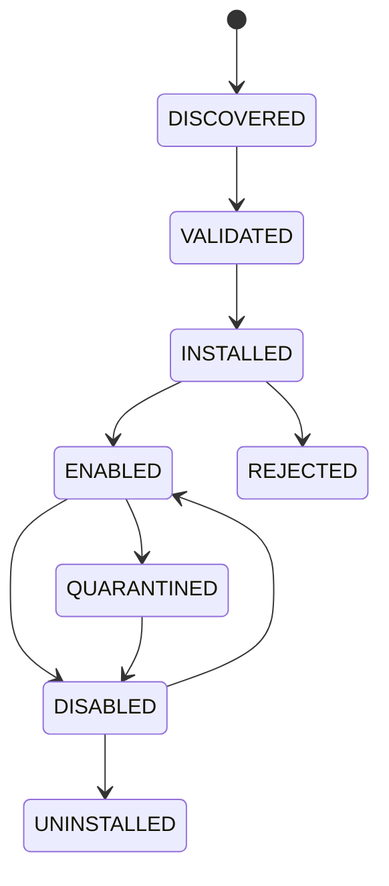

# LingSQL Agent 插件底座架构

> 状态：已采纳，第一阶段实施中
>
> 决策日期：2026-08-15
> 技术基线：Java 25、Spring Boot 4.1、Spring AI 2.0

## 1. 产品定位

LingSQL 定位为企业级 AI 数据 Agent 底座。底座负责模型接入、执行编排、租户上下文、安全策略、预算、计费、审计和恢复；生态开发者在这些边界之上扩展 Agent、Skill、Tool、数据源、知识库、工作流和展示能力。

“无限扩展”的准确含义是扩展点可以持续增加，但每个扩展的权限、预算和数据边界必须有限且可审计。

## 2. 核心决策

1. 核心实现使用 Java，不引入 Python 运行时。
2. Spring AI 当前用于模型调用；ToolCallback、Advisor、VectorStore 和 MCP 是后续首选适配方向。Spring AI 不拥有业务状态机，也不直接获得 JDBC 权限。
3. 当前问数主链采用确定性状态流，不允许模型改变 SQL 安全顺序。
4. 内置插件使用类型安全 Java SPI 和 Spring Bean 注册；可信 JAR 插件后续可评估 PF4J；第三方或不可信插件必须使用独立进程 MCP/HTTP。
5. 内置受控工作流统一经过 Plugin Gateway；当前已强制检查白名单、系统调用来源、调用次数、成本等级、启动/返回 deadline 和输入输出类型。物理模型调用已经逐次预留、派发、结算或保留为 `UNKNOWN`；租户级插件授权、可取消超时、统一插件调用审计与非模型 Plugin/MCP 实际费用结算属于下一阶段。
6. SQL 的“租户隔离改写 → 安全校验 → JDBC 查询”是不可拆分的系统能力，普通插件不能替换或绕过。
7. 用户、租户、会话和请求身份通过 `AgentExecutionContext` 显式传递，核心执行链不得依赖 ThreadLocal 获取身份。

## 3. 总体架构



### 3.1 分层职责

| 层 | 主要职责 | 允许依赖 | 禁止事项 |
| --- | --- | --- | --- |
| 接入层 | REST、SSE、WebSocket、定时任务、事件入口、MCP Server | 应用层 DTO 和用例接口 | 编排、持久化和业务判断 |
| 应用层 | 建立执行上下文、选择工作流、保存用户可见结果 | 编排 API、身份和会话接口 | 直接调用模型、插件或 JDBC |
| 编排层 | Agent/Task 状态流、预算、恢复、审批、结果聚合 | Plugin Gateway、模型网关、checkpoint | 绕过插件网关和安全策略 |
| 插件治理层 | 注册、授权、版本、生命周期、输入输出校验、审计 | 插件 SPI、策略、凭据代理 | 信任插件自报权限 |
| 能力层 | SQL、知识检索、指标、图表、报表等插件实现 | 明确声明的平台端口 | 读取未授权租户上下文 |
| 基础设施层 | 数据库、Redis、向量库、模型、MCP、消息和对象存储适配 | 第三方 SDK | 向上反向依赖业务实现 |
| 管理平面 | 插件目录、租户授权、预算、审批、评测、运营和审计 | 所有只读管理端口 | 绕过数据平面执行工具 |

### 3.2 核心术语

- **Agent**：对目标、角色、策略和可用插件的受控组合，不等同于一个模型实例。
- **Task**：可持久化的工作单元，拥有输入、状态、预算、依赖、重试和结果。
- **Skill**：可复用的业务能力定义，可以由一个插件完成，也可以编排多个 Tool。
- **Tool**：一次可执行的原子能力，拥有结构化输入输出和明确副作用。
- **Plugin**：承载一个或多个 Skill/Tool 的可部署扩展单元。
- **Workflow**：由类型化状态、迁移条件、预算和恢复点组成的执行图。
- **Semantic Context**：对业务指标、实体、维度、Join 和批准示例的版本化定义。
- **Knowledge Base**：可检索、可引用、受权限控制的非结构化或半结构化知识集合。

## 4. 受控运行模型

当前代码的实际顺序如下。SQL 架构师和业务分析师共享结构化 `IModelGateway`；网关内部的 `IPhysicalModelBilling` 在每次真实网络调用前持久预留和派发，返回可信用量后结算并退款。合规审计员仍是确定性 Java 模块，不调用模型：



`UNKNOWN` 首次裁决会写入唯一不可变记录；相同证据与结论的重放返回原回执，不同证据或结论会被拒绝。裁决只保存证据 SHA-256 摘要，不保存供应商账单正文。该 API 和确定性全栈验收已经落地，但供应商账单自动导入、自动匹配和人工工作台尚未完成。

以下状态图是完成统一用量事件、持久 checkpoint 和恢复后的目标模型，不是当前已交付状态：



SQL 架构师、合规审计员和业务分析师是受控角色，不是三个可以任意对话、任意调用工具的自治 Agent。后续增加动态规划时，规划结果也只能选择策略允许的状态和插件。

### 4.1 执行上下文

`AgentExecutionContext` 至少携带 `executionId`、`requestId`、`tenantId`、`userId` 和 `conversationId`。这些字段由应用层建立后显式向下传递。租户和用户身份不能由模型生成；适配 Spring AI Tool 时应放入不会发送给模型的 `ToolContext`。

### 4.2 运行策略与预算

`AgentRunPolicy` 定义单次运行允许的插件、调用来源、最大插件调用次数、成本单位、最大 SQL 尝试次数和 deadline。`AgentRunControl` 当前在插件启动前及返回后做 deadline 检查，但不能中断已经运行的模型或 JDBC 调用，因此这只是截止时间防护基础，不是全链路可取消超时。

后续预算继续覆盖模型调用次数、输入/输出 Token、费用上限、结果行数、并发数和人工审批点。

### 4.3 Task 与状态迁移

目标状态模型至少包含 `CREATED`、`READY`、`RUNNING`、`WAITING_APPROVAL`、`WAITING_RETRY`、`SUCCEEDED`、`DEGRADED`、`FAILED`、`CANCELLED` 和 `COMPENSATING`。状态迁移必须由平台枚举和策略决定，工作流配置不得填写任意 Java 类名、SpEL、脚本或 SQL。

每个 Task 记录：任务 ID、执行 ID、父任务 ID、工作流版本、插件 ID/版本、输入摘要、状态、尝试次数、预算快照、幂等键、checkpoint、错误分类、创建/开始/完成时间。敏感输入不直接写入任务表，只保存脱敏摘要或加密引用。

### 4.4 并行、委派与汇总

编排器可以在策略允许时并行执行互不依赖的只读 Task，例如同时检索业务术语和文档知识。具有副作用、共享预算或依赖相同审批的 Task 默认串行。父 Agent 可以委派子 Agent，但必须显式传递缩减后的权限和预算，子 Agent 不能获得父 Agent 未拥有的能力。

并行结果由确定性聚合器汇总；模型只负责语义归纳，不能决定遗漏失败分支或修改真实执行状态。

### 4.5 持久 checkpoint 与恢复

目标实现需要在状态迁移后保存 checkpoint，至少包含工作流版本、已完成 Task、剩余预算、插件版本、外部调用幂等键和可公开结果引用。恢复时必须验证：

1. 工作流定义与插件版本仍兼容。
2. 租户、用户和授权仍有效。
3. 已完成副作用有幂等凭证或补偿记录。
4. 恢复入口位于安全边界之前，不能从“审计通过但尚未执行”的中间缝隙直接恢复。
5. 超过保留期或策略已变更的 checkpoint 转人工处理，不自动续跑。

## 5. 插件模型

### 5.1 插件契约

内置插件实现 `IAgentPlugin<I, O>`，必须声明唯一 ID、语义版本、输入/输出 Java 类型、访问级别、成本等级、幂等性和中文能力说明。

注册中心在应用启动时校验元数据和重复 ID，失败则阻止启动；原始插件查找仅对网关包内可见。聊天主链与数字员工执行都必须通过网关，ArchUnit 已强制禁止网关外直连 `secure_query`。Spring Modulith 模块边界尚未强制，完成前不能宣称“所有路径不可绕过”。

### 5.2 三类扩展

| 类型 | 运行位置 | 适用场景 | 信任要求 | 当前状态 |
| --- | --- | --- | --- | --- |
| 内置插件 | 主 JVM、Spring Bean | 核心能力和高频低延迟能力 | 随主仓库审查 | 已建立 SPI |
| 可信 JAR 插件 | 独立 ClassLoader | 客户私有扩展、可停启能力 | 签名、审核、版本兼容 | 规划，候选 PF4J |
| 远程插件 | 独立进程、MCP/HTTP | 第三方生态、不可信代码、跨语言能力 | OAuth、网络策略、租户授权 | 规划，首选 MCP |

PF4J 的 ClassLoader 隔离不是安全沙箱。未经审核的第三方代码不得加载到主 JVM，必须放在独立进程或容器中。

### 5.3 系统插件 `secure_query`

`secure_query` 固定执行：租户数据源解析 → 候选 SQL 生成 → 租户隔离改写 → SQL 安全校验 → JDBC 只读查询 → 费用结算和审计落库。

普通插件不得注入业务 `JdbcTemplate`，也不得接收“已批准 SQL”类型。通过审计的 SQL 只在安全执行包内部流转。

### 5.4 插件清单

每个可部署插件必须附带平台清单。目标字段如下：

```yaml
id: finance.margin-analysis
name: 毛利分析
version: 1.2.0
apiVersion: lingsql.io/v1
runtime: BUILTIN | TRUSTED_JAR | MCP
entrypoints:
  - skill: calculate_margin
    inputSchema: classpath:/schemas/calculate-margin-input.json
    outputSchema: classpath:/schemas/calculate-margin-output.json
permissions:
  - semantic.read
  - query.read
costLevel: MEDIUM
idempotent: true
timeout: 20s
minPlatformVersion: 1.1.0
publisher: example-company
signature: sha256:...
```

平台保存并签名实际生效的清单快照。模型看到的工具描述由平台从批准清单生成，不直接信任远程服务返回的描述。

### 5.5 插件生命周期



- `DISCOVERED`：找到包或远程端点，尚不可调用。
- `VALIDATED`：签名、清单、Schema、兼容性和安全扫描通过。
- `INSTALLED`：平台记录版本和来源，但尚未授权租户。
- `ENABLED`：已通过平台与租户双重授权，可由策略选择。
- `QUARANTINED`：出现异常、签名变化、SLO 或安全违规，立即隔离。
- `UNINSTALLED`：停止新调用；历史执行仍保留原插件版本和摘要。

升级采用并存版本和灰度路由，不能原地覆盖正在运行的版本。回滚只切换新任务路由，历史 checkpoint 继续绑定原版本或进入兼容迁移。

### 5.6 扩展适配器

内置 SPI 是平台稳定内核。目标适配器将把 Spring AI `ToolCallback`、PF4J Extension 和 MCP Tool 转换成统一插件描述和调用请求，并负责 Schema 生成、上下文注入、错误归一、超时、取消和使用量采集，但不能绕过 Plugin Gateway。三类适配器当前尚未实现，不能作为现有能力对外承诺。

## 6. 知识库与语义上下文

知识能力分为两层：

1. **语义上下文库**：指标定义、业务术语、字段含义、Join 规则和批准 SQL 示例。它直接影响 SQL 生成，必须可版本化、可评审、可回滚。
2. **通用知识库**：产品文档、制度、合同、FAQ、Wiki 等，通过 RAG 检索为回答提供事实与引用。

规划中的 `knowledge_retrieve` 插件通过 Spring AI `VectorStore`/ETL 抽象适配不同向量库。检索必须携带租户和文档权限过滤，并审计知识版本、Embedding 模型版本、命中文档、引用来源、Token 和费用。知识内容不能覆盖系统安全策略。

### 6.1 知识摄取流水线

目标流水线为：数据源授权 → 拉取/上传 → 类型识别 → 病毒与内容安全检查 → 解析 → 规范化 → 分块 → 敏感信息分类 → 元数据与 ACL 注入 → Embedding → 向量/关键词索引 → 质量抽检 → 发布版本。

原文存对象存储，结构化元数据和版本存管理库，向量存储只保存必要片段和稳定引用。更新采用新版本构建与原子发布，删除进入索引清除和缓存失效流程。

### 6.2 检索流水线

目标检索为：意图分类 → 查询改写 → 租户/用户/文档 ACL 过滤 → 语义与关键词混合召回 → 重排 → 去重 → 证据阈值 → 上下文压缩 → 引用绑定。无足够证据时返回“不足”，不能让模型自行补齐事实。

每条证据携带 `knowledgeBaseId`、`documentId`、版本、片段位置、来源 URI、权限标签、检索分数和发布时间。最终答案的引用必须能回到用户有权查看的原始来源。

### 6.3 语义层模型

语义层至少定义 Entity、Dimension、Measure、Metric、Relationship、Enum、TimeGrain、DataPolicy 和 ApprovedQuery。定义使用不可变版本发布，草稿、评审、发布、废弃和回滚分离。SQL 生成记录所用语义版本，便于复现和回归。

## 7. 记忆与平台能力

| 记忆类型 | 目标用途 | 当前状态 |
| --- | --- | --- |
| 短期记忆 | 会话窗口和临时实体引用 | 已实现 Redis 会话窗口；默认 10 条、30 分钟 TTL |
| 长期记忆 | 用户偏好、历史事实和跨会话上下文 | 规划；MySQL 聊天历史仅用于展示，不等于长期记忆检索 |
| 语义记忆 | 指标、术语、维度、Join、枚举和批准 SQL | 部分实现语义字典与 Join 规则，尚未版本化 |
| 程序记忆 | 已验证工作流、插件组合和恢复经验 | 规划 |

新架构预留“永久记忆”扩展点，但当前不支持永久记忆。未来该词只表示可跨会话持久化，不表示永不删除；所有长期记忆必须配置保留期、来源、可信度、租户范围、用户删除和管理员清除能力，敏感信息默认不得进入模型记忆。

底座的完整能力面还包括：

- 受控多 Agent、条件分支、并行任务、委派与汇总。
- 定时和事件触发、人工审批、暂停恢复和持久 checkpoint。
- 模型、数据源、知识库和展示插件。
- 幂等、有限重试、超时、熔断、补偿和失败队列。
- Token、费用、并发、结果行数和插件调用预算。
- 插件签名、版本兼容、安装、启停、升级和回滚。
- 逐阶段 Trace、SLO、质量评测和模型/提示词 A/B。
- 表格、图表、Dashboard、Excel/PDF、消息推送和嵌入式组件。

这些能力必须在“实施状态”中逐项区分已实现与规划，禁止把架构支持宣传成已交付功能。

### 7.1 记忆写入治理

模型不能自行决定永久保存全部对话。记忆写入经过候选提取、敏感分类、事实验证、去重、置信度、保留期和用户/租户授权。记忆读取同样经过权限过滤，并向回答标明来源和时间。用户纠正会创建新版本并使旧事实失效，而不是无痕覆盖。

### 7.2 Agent 模板

平台目标支持 SQL 分析 Agent、知识问答 Agent、报表 Agent、审批 Agent、运维 Agent 和客户自定义 Agent。模板只引用批准的工作流、模型策略、插件集合、知识库、记忆策略、预算和输出契约；禁止模板携带可执行脚本或明文凭据。

## 8. Spring AI 与 MCP 边界

Spring AI 2.0 当前只用于统一模型调用。ToolCallback、Advisor、VectorStore 和 MCP 尚未接入，是后续标准适配方向。底座不会把所有插件注册为模型默认工具；高风险工具必须按请求、按租户动态授权，工具数量增大后采用按需发现。

远程插件使用 MCP/HTTP 时必须进入平台网关。插件自报名称、描述和权限不是授权依据；授权以平台注册记录、签名和租户策略为准。

### 8.1 Spring AI 使用方式

- `ChatModel`/`ChatClient` 负责模型协议与对话调用。
- `Advisor` 承载可组合的记忆、RAG、观测和工具循环，但业务状态迁移仍由 LingSQL 编排器拥有。
- `ToolContext` 传递不向模型公开的租户、用户、执行和授权信息。
- `ToolCallback` 只作为模型工具适配接口，高风险插件按单次请求注入。
- 工具数量较大时按需检索工具定义，不把完整插件目录发送给模型。

### 8.2 MCP 网关

MCP Client 连接配置属于平台资产，包含服务器身份、传输、认证、允许的工具、Schema 快照、网络出口和租户授权。生产优先 Streamable HTTP；本地 STDIO 只用于可信桌面或开发环境。

网关必须防御工具投毒、名称碰撞、Schema 漂移、提示注入、跨工具数据外泄和 confused deputy。远程工具返回的文本按不可信数据处理，不能成为系统指令。连接和工具变更触发重新审批，运行中发现描述或 Schema 漂移时隔离服务器。

## 9. 安全与治理不变量

1. 模型只能提出工具调用请求，应用程序决定是否执行。
2. 系统插件 ID 不能被第三方覆盖。
3. 所有外部输入执行长度、格式、范围和注入校验。
4. 工具参数和结果默认不写入 Trace 内容；需要观测时先脱敏并显式启用。
5. 远程插件使用最小权限认证，凭据不得转发给模型或其他插件。
6. 插件超时、预算耗尽、拒绝和异常路径必须产生结构化审计事件；当前管理操作已使用持久审计投递箱，插件调用的独立事件表/Outbox 尚未完成。
7. 计费或审计结算失败不能静默吞掉，必须失败、补偿或进入持久化待处理队列。

### 9.1 权限模型

权限决策至少包含平台主体、租户、用户、角色、Agent、工作流、插件、工具、资源和动作。最终授权是这些约束的交集。系统采用 deny-by-default；模型输出、插件清单和远程服务器声明都不能提升权限。

凭据由平台 Secret Provider 按调用注入，插件只获得短期、范围受限的句柄或令牌。日志、Trace、Prompt、checkpoint、插件结果和错误消息统一经过脱敏策略。

### 9.2 授权会话深模块

`IAuthorizationSessionLifecycle` 是授权会话的单一深模块 Interface，只暴露三个用例：`publish` 在同一 MySQL 事务内提交授权事实并递增版本，`capture` 根据用户、租户及排序后的角色版本生成不可变指纹，`validate` 逐请求复核主体状态、租户到期时间和指纹。版本事实分别位于用户、角色和租户表；缺失、查询异常或版本不一致一律失败关闭。

完整会话装配在读取角色、权限、直接数据范围、体验策略和组织派生范围之前捕获一次版本，装配完成后再次捕获；两次不一致时拒绝签发。第一次捕获后会重新读取权威用户，避免把捕获前缓存的体验账号或凭据状态带入新会话。`PASSWORD_CHANGE_ONLY` 会话不包含动态授权快照，只需一次捕获。

普通用户的最终权限是有效角色权限与租户权限池的交集；租户权限池为空时返回空权限，不解释为无限制。`SUPER_ADMIN` 仅保留系统管理角色的明确例外。Access Token 与 Refresh Token 都携带授权指纹，旧 Token 缺少指纹时拒绝使用。

Redis 只在 MySQL 事务 `afterCommit` 后清理 Access/Refresh 会话，用于缩短失效传播时间；Redis 清理失败不会改变已经提交的接口语义，也不会放宽授权，因为后续请求仍以 MySQL 版本为权威。该模块是工程安全边界，不代表已完成客户环境安全验收。

### 9.3 供应链治理

可信 JAR 插件要求制品哈希、发布者签名、SBOM、许可证、漏洞扫描、最低平台版本和可回滚版本。MCP 插件要求服务器身份固定、TLS、OAuth/工作负载身份、工具清单快照和网络允许列表。任何插件升级都先进入隔离环境完成契约测试和安全检查。

### 9.4 计费、审计与补偿

每次物理模型调用已经产生独立 `invocationId` 和资金状态，记录 tenant/workflow/caller/stage/route/provider/model、实际模型配置 ID、调用时模型版本、选择时租户授权路由指纹、Prompt 摘要、最大与实际 Token、冻结价格、预留/实际/退款金额和终态；不保存 Prompt、模型原文、密钥或客户结果。`TenantModelRouting` 先按租户读取显式授权，只保留全局启用且最近真实探测为 `HEALTHY` 的物理模型，再冻结不可变 `ModelRoutePlan`。主模型和备用模型只能从该计划选择，不得在备用阶段重新查询全局池；未授权租户失败关闭。模型网关将计划指纹显式传给计费模块，禁止从 ThreadLocal 或事后当前配置反推。余额预留、`RESERVED -> DISPATCHED`、实际结算和差额退款均以 MySQL 为事实源，Redis 只作为可重建投影。

模型网关是深模块：业务侧只提交显式 `ModelCallCommand` 并接收 `ModelCallResult`；内部适配器才执行一次指定模型的物理调用。主模型与备用模型不能共享资金事件。只有本地配置准备阶段明确尚未出站时才能换备用模型；一旦进入 `DISPATCHED`，异常只能进入 `UNKNOWN`，不能自动退款或继续用同一资金事件重试。

管理操作审计已采用 durable inbox：执行业务前以独立事务写入 `PREPARED` 意图，写入失败则拒绝管理操作；业务完成后确认 `SUCCESS/FAILED` 并按 `eventId` 幂等发布，进程中断留下的意图只会转为 `UNKNOWN` 等待人工核对。投递失败会退避重试并最终进入 `DEAD`，两种异常状态都会触发健康失败，留存任务只删除已投递记录。

该实现保证管理操作意图不被进程重启和队列溢出静默丢弃，但不宣称外部副作用 exactly-once：外部系统已经执行而结果尚未写回时，只能记录 `UNKNOWN`。模型调用已经使用专用持久资金状态机；非模型 Plugin/MCP 工具仍需独立的用量事件和补偿模块，不能把工具费用伪装成模型 Token。

## 10. 参考项目与取舍

- [WrenAI](https://github.com/Canner/WrenAI)：吸收可版本化语义层、执行前计划校验、结构化错误和评测基线；不引入其 Python 运行时。
- [DB-GPT](https://github.com/eosphoros-ai/DB-GPT)：吸收 Agent、Skills 和沙箱分层；不照搬 Python 技术栈。
- [Agentar-Scale-SQL](https://github.com/antgroup/Agentar-Scale-SQL)：吸收多候选生成和确定性选择；只在预算允许且可验证时启用。
- [Vanna](https://github.com/vanna-ai/vanna)：吸收用户上下文贯穿工具和 SQL 安全链的设计；其仓库已归档，不作为依赖。
- [SQLBot](https://github.com/dataease/SQLBot)：吸收术语库、SQL 示例校准和嵌入式交付体验；许可证有额外限制，不复制代码或品牌资产。
- [Chat2DB](https://github.com/OtterMind/Chat2DB)：吸收密钥 fail-fast、数据源插件化和本地部署安全边界；其单用户本地定位不能替代多租户底座。

技术依据：

- [Spring AI Tool Calling](https://docs.spring.io/spring-ai/reference/api/tools.html)
- [Spring AI MCP](https://docs.spring.io/spring-ai/reference/api/mcp/mcp-overview.html)
- [Spring AI Vector Databases](https://docs.spring.io/spring-ai/reference/api/vectordbs.html)
- [Spring Modulith 模块校验](https://docs.spring.io/spring-modulith/reference/verification.html)
- [PF4J 插件生命周期](https://pf4j.org/doc/plugin-lifecycle.html)
- [MCP 2026-07-28 规范发布说明](https://blog.modelcontextprotocol.io/posts/2026-07-28/)

## 11. 目标模块与数据模型

### 11.1 目标模块

| 模块 | 稳定对外接口 | 内部职责 |
| --- | --- | --- |
| `agent-runtime` | Run、resume、cancel | 状态机、Task、checkpoint、预算 |
| `plugin-api` | SPI、Descriptor、Schema | 插件稳定契约，不依赖业务实现 |
| `plugin-governance` | install、authorize、invoke | 注册、签名、版本、策略、审计 |
| `model-gateway` | model call/stream | Spring AI、路由、熔断、用量 |
| `semantic-context` | resolve/publish | 指标、实体、Join、版本治理 |
| `knowledge` | ingest/retrieve/cite | 文档、索引、ACL、引用 |
| `memory` | remember/recall/forget | 四类记忆、保留期、删除 |
| `secure-query` | typed query task | SQL 生成、安全审计、JDBC |
| `billing-audit` | reserve/settle/replay | 预算、账本、Outbox、审计 |
| `management-plane` | admin APIs | 插件、Agent、知识、评测、运营 |

### 11.2 目标核心实体

- `AgentDefinition`、`AgentVersion`
- `WorkflowDefinition`、`WorkflowVersion`
- `AgentExecution`、`AgentTask`、`AgentCheckpoint`
- `PluginPackage`、`PluginVersion`、`PluginTenantGrant`
- `ToolDefinitionSnapshot`、`PluginInvocation`
- `SemanticModel`、`SemanticModelVersion`
- `KnowledgeBase`、`KnowledgeDocument`、`KnowledgeChunkVersion`
- `MemoryEntry`、`MemoryRevision`、`MemoryRetentionPolicy`
- `UsageEvent`、`BillingReservation`、`BillingSettlement`、`AuditOutbox`

表结构实施时遵循仓库命名约束，并通过正式迁移链管理，不再依赖不可审计的手工补丁。

## 12. 部署拓扑

最小部署由 LingSQL 应用、管理 MySQL、Redis、租户业务数据库和模型服务组成。知识库增加对象存储与向量库；远程插件增加 MCP Gateway；高风险代码执行插件增加独立沙箱执行集群。

控制面和数据面逻辑分离：控制面管理定义、授权、版本和运营；数据面只执行已发布快照。多实例部署时插件目录、工作流版本、checkpoint 和预算存共享存储，本地缓存必须按版本键失效。

生产拓扑要求 TLS、最小权限数据库账号、私网连接、Secret Manager、备份恢复、跨可用区存储、MCP 出口限制和每租户资源配额。虚拟线程优化阻塞 I/O 并发，但不能替代连接池、速率限制和下游容量保护。

## 13. 管理平面与生态

目标管理能力包括：

- Agent/工作流草稿、验证、发布、灰度和回滚。
- 插件发现、上传、签名验证、安装、启停、隔离、升级和租户授权。
- MCP 服务器注册、OAuth 配置、工具审批和 Schema 漂移告警。
- 知识库数据源、摄取任务、版本发布、ACL、质量和删除。
- 记忆策略、查看、纠正、删除、保留期和隐私导出。
- 预算、套餐、插件价格、用量、对账和补偿队列。
- Trace、SLO、评测集、模型/Prompt/插件版本对比和回归门禁。
- 插件开发 SDK、示例、契约校验 CLI、私有插件仓库和后续插件市场。

生态发布的插件必须明确许可证、数据使用、网络访问、费用、权限、支持平台版本和维护者。商业市场还需要结算、退款、下架、漏洞通知和客户升级策略。

## 14. 实施状态

### 已实现

- Spring AI 2.0 模型网关、租户显式授权路由和模型熔断。
- 无 API Key 的内网 OpenAI-compatible Java 传输兼容。
- `AgentExecutionContext` 显式上下文。
- `IControlledAgentOrchestrator` 固定状态流入口。
- `IAgentPlugin`、插件描述、注册中心和统一执行网关。
- 插件白名单、系统调用来源、成本等级、调用次数、SQL 尝试次数和启动/返回 deadline 防护基础。
- 策略拒绝、预算、deadline、计费、审计和插件故障的稳定失败分类与上下文日志。
- `secure_query` 系统插件。
- SQL 审计通过类型只在安全查询包内流转，轨迹按真实执行顺序产生。
- 结构化模型调用命令与结果、逐物理调用 `RESERVED/DISPATCHED/SETTLED/CANCELLED/UNKNOWN` 状态机、MySQL 原子预留与差额退款、陈旧状态恢复和健康门禁。
- SQL 架构师、业务分析师、Schema 扫描和元数据语义建议已移除模型用量 ThreadLocal，统一显式传递工作流身份和调用序号。
- `UNKNOWN` 管理端裁决 API：外部证据摘要、操作人、唯一不可变裁决记录、同请求幂等重放和冲突拒绝均已落地；确定性全栈场景覆盖“确认用量”和“确认未计费”两条路径。
- 计费验收会话可冻结租户 MySQL 余额与账本水位，对精确请求集合校验调用终态、已应用账本、区间归因和余额守恒，并签发不可变验收回执。
- 每次物理调用冻结实际 `modelConfigId`、模型版本和路由指纹；账本证据与 40 题验收可据此核对候选运行指纹，历史缺失身份的调用不会被伪造回填。
- 租户模型授权路由：物理模型和租户授权分离；每租户独立优先级/权重，未授权默认拒绝，主备调用复用同一不可变计划，运行指纹按被验收租户生成。
- 插件治理面：注册中心元数据只读目录与租户插件授权维护接口，以及管理端页面（插件目录、租户授权开关与 fail-closed 说明）；受控业务插件（`ORCHESTRATED`）未授权时在统一执行网关层 fail-closed 且不消耗预算，系统插件由受控工作流固定调用、不参与租户授权。`AgentToolProvider` 等入口统一改经执行网关调用插件，不再直达插件实例。

### 下一阶段

1. 将语义字典升级为可版本化 Semantic Context。
2. 实现 `knowledge_retrieve`、`calculate_metric`、`chart_mapper` 插件。
3. 建立持久化 Agent checkpoint、幂等恢复和非模型插件用量 Outbox；增加供应商账单自动导入、自动匹配和 `UNKNOWN` 裁决工作台。管理端裁决 API 已实现，不再重复建设另一条核销入口。
4. 将模型调用和 Token 预算纳入统一 `AgentRunControl`。
5. 建立插件版本兼容矩阵与升级/回滚演练；插件管理 API 与租户授权已落地，JAR 与清单签名校验已实现但仍需真实环境验证。
6. 实现 Spring AI `ToolCallback` 适配器、按需工具发现和 MCP 远程插件网关。
7. 引入 Spring Modulith 或等价架构检查，阻止跨模块访问内部类型和 JDBC 绕过。
8. 建立 Text-to-SQL 评测集、回归基线和多候选选择策略。
9. 以 Spring Modulith 强制插件网关与 JDBC 模块边界（数字员工迁移到执行网关与 ArchUnit 调用边界已落地）。
10. 将残留会话读取从 `TenantContext` 迁移为显式上下文，并为结构化并发和持久恢复建立上下文快照。

### 目标完成定义

只有在以下条件同时满足时，才能宣称“插件化 Agent 底座完成”：

1. 内置、可信 JAR、MCP 三类插件至少各有一个生产验证实现。
2. 插件安装、授权、预算、审计、升级、隔离和回滚闭环可演练。
3. 知识库和四类记忆具备租户 ACL、版本、引用、删除和保留期。
4. Agent 执行可 checkpoint、恢复、取消、幂等和补偿。
5. 模型与插件逐调用 Token/费用进入统一账本且可对账。
6. 安全、容量、故障恢复和真实业务评测门禁通过。
7. 文档中的“已实现”与代码、测试、部署证据一致。

## 15. 禁止事项

- 禁止为了“多 Agent”展示效果而让多个角色无界互相调用。
- 禁止让模型生成租户 ID、用户 ID、权限或计费参数。
- 禁止普通插件直接访问业务 JDBC、密钥存储或租户上下文 ThreadLocal。
- 禁止把第三方 JAR 的 ClassLoader 隔离宣传为安全沙箱。
- 禁止默认向模型暴露所有插件。
- 禁止在没有签名、兼容检查、权限声明和回滚策略时开放热加载。
