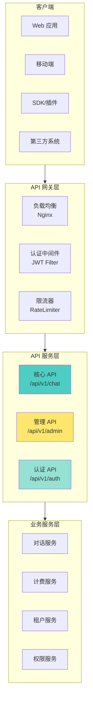
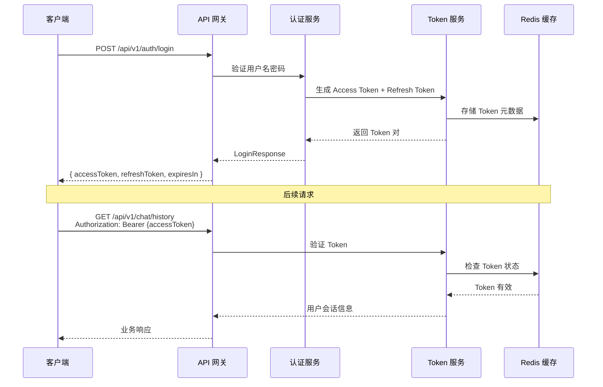
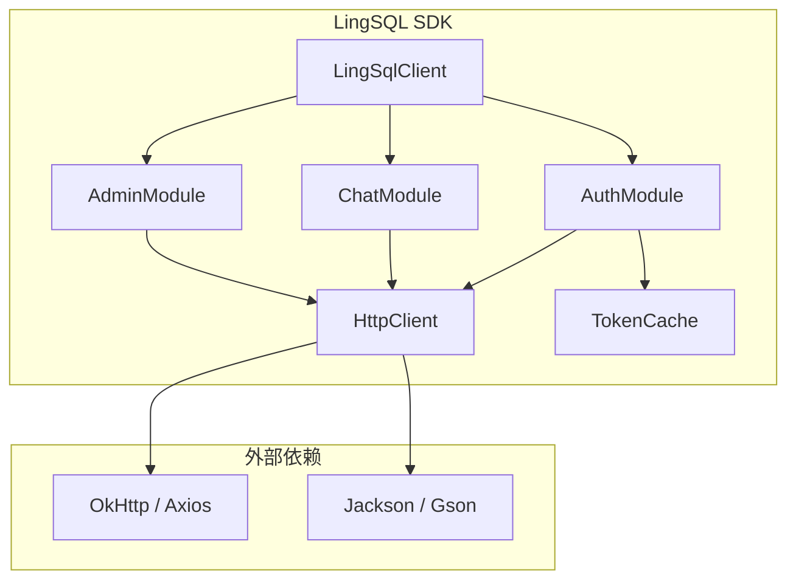
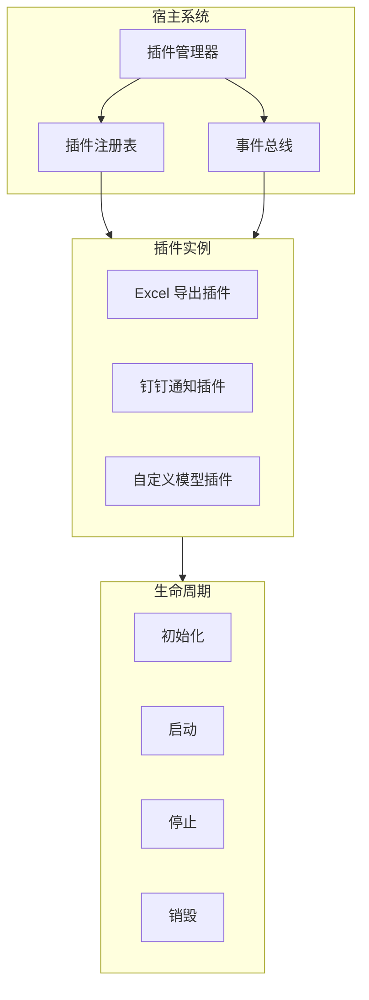
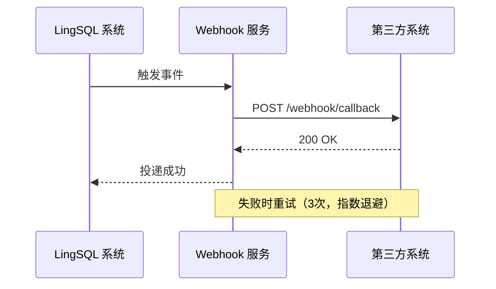
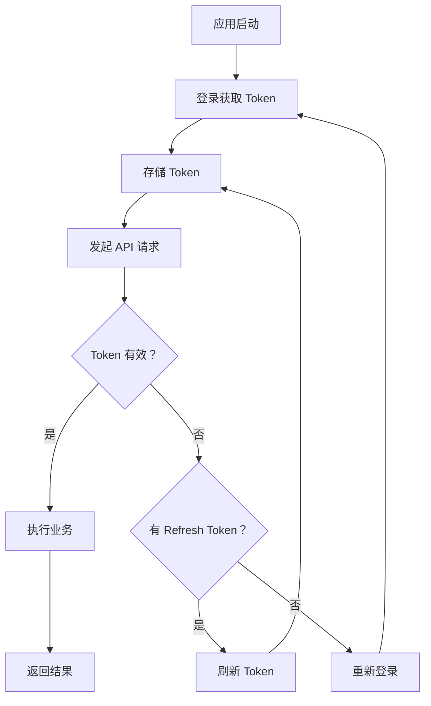

# LingSQL Engine OpenAPI & 插件集成指南

> **当前状态说明（2026-08-15）**：本文保留部分目标 API 和 SDK 设计供架构评审，不代表对应 SDK、插件安装器或远程插件已经发布。当前正式实现边界以 `README.md` 和 [Agent 插件底座架构](Agent插件底座架构.md) 为准。项目只维护 Java 后端和 TypeScript/Vue 管理端，不提供 Python SDK。

> **版本**: v1.0
> **更新日期**: 2026-01-29
> **文档状态**: 正式发布
> **适用对象**: 前端开发者、第三方集成商、插件开发者、API 用户

---

## 目录

1. [API 概述](#1-api-概述)
2. [认证与授权](#2-认证与授权)
3. [核心 API 接口](#3-核心-api-接口)
4. [管理 API 接口](#4-管理-api-接口)
5. [错误码字典](#5-错误码字典)
6. [请求与响应规范](#6-请求与响应规范)
7. [SDK 开发指南](#7-sdk-开发指南)
8. [插件开发规范](#8-插件开发规范)
9. [Webhook 集成](#9-webhook-集成)
10. [最佳实践](#10-最佳实践)
11. [FAQ](#11-faq)

---

## 1. API 概述

### 1.1 API 架构



### 1.2 API 基本信息

| 项目 | 说明 |
|------|------|
| **Base URL** | `https://api.lingsql.com` |
| **API 版本** | `v1` |
| **协议** | HTTPS (TLS 1.2+) |
| **数据格式** | JSON (UTF-8) |
| **认证方式** | Bearer Token (JWT) |
| **时区** | UTC / Asia/Shanghai |

### 1.3 API 模块概览

| 模块 | 路径前缀 | 说明 | 权限要求 |
|------|----------|------|----------|
| **认证** | `/api/v1/auth` | 登录、登出、刷新 Token | 公开 / 已认证 |
| **对话** | `/api/v1/chat` | 核心问答、历史记录 | 已认证 + API 权限 |
| **元数据** | `/api/v1/admin/metadata` | Schema 管理、AI 建议 | 管理员 |
| **租户管理** | `/api/v1/admin/tenants` | 租户 CRUD | 系统管理员 |
| **用户管理** | `/api/v1/admin/users` | 用户 CRUD | 管理员 |
| **角色管理** | `/api/v1/admin/roles` | 角色 CRUD | 管理员 |
| **权限管理** | `/api/v1/admin/permissions` | 权限配置 | 系统管理员 |
| **计费管理** | `/api/v1/admin/billing` | 策略、定价配置 | 系统管理员 |
| **审计日志** | `/api/v1/admin/audit` | 操作日志查询 | 管理员 |
| **运行配置** | `/api/v1/admin/config` | 系统运行配置 | 系统管理员 |
| **收益仪表盘** | `/api/v1/admin/profit` | 收益统计分析 | 系统管理员 |

### 1.4 控制器清单

系统共包含 **15 个控制器**，提供约 **97 个 API 端点**：

```java
// 控制器清单（源自 com.lingsql.web 包）
├── AuthController          // 认证相关
├── ChatController          // 核心问答
├── MetadataController      // 元数据管理
├── TenantAdminController   // 租户管理
├── UserAdminController     // 用户管理
├── RoleAdminController     // 角色管理
├── PermissionAdminController // 权限管理
├── BillingAdminController  // 计费管理
├── AuditLogController      // 审计日志
├── AdminController         // 通用管理
├── AdminConfigController   // 配置管理
├── RuntimeConfigController // 运行时配置
├── ExperiencePolicyController // 体验策略
├── ProfitDashboardController  // 收益仪表盘
└── BaseController          // 基础控制器
```

---

## 2. 认证与授权

### 2.1 认证流程



### 2.2 登录接口

**请求**：

```http
POST /api/v1/auth/login
Content-Type: application/json

{
  "username": "admin",
  "password": "password123",
  "tenantId": "tenant_001"  // 可选，不传则使用默认租户
}
```

**响应**：

```json
{
  "code": 200,
  "message": "success",
  "data": {
    "accessToken": "eyJhbGciOiJIUzI1NiIsInR5cCI6IkpXVCJ9...",
    "refreshToken": "eyJhbGciOiJIUzI1NiIsInR5cCI6IkpXVCJ9...",
    "tokenType": "Bearer",
    "expiresIn": 7200,
    "refreshExpiresIn": 604800
  }
}
```

### 2.3 Token 刷新

**请求**：

```http
POST /api/v1/auth/refresh
X-Refresh-Token: {refreshToken}
```

**响应**：

```json
{
  "code": 200,
  "message": "success",
  "data": {
    "accessToken": "eyJhbGciOiJIUzI1NiIsInR5cCI6IkpXVCJ9...",
    "refreshToken": "eyJhbGciOiJIUzI1NiIsInR5cCI6IkpXVCJ9...",
    "tokenType": "Bearer",
    "expiresIn": 7200,
    "refreshExpiresIn": 604800
  }
}
```

### 2.4 获取当前用户信息

**请求**：

```http
GET /api/v1/auth/me
Authorization: Bearer {accessToken}
```

**响应**：

```json
{
  "code": 200,
  "message": "success",
  "data": {
    "userId": 12345,
    "tenantId": "tenant_001",
    "username": "admin",
    "nickname": "管理员",
    "experience": false,
    "roles": ["ADMIN", "USER"],
    "permissions": ["API:CHAT:ASK", "API:CHAT:HISTORY:READ"],
    "dataScope": "ALL"
  }
}
```

### 2.5 退出登录

**请求**：

```http
POST /api/v1/auth/logout
Authorization: Bearer {accessToken}
X-Refresh-Token: {refreshToken}
```

**响应**：

```json
{
  "code": 200,
  "message": "success",
  "data": "已退出登录"
}
```

### 2.6 请求头规范

| Header | 必填 | 说明 |
|--------|------|------|
| `Authorization` | 是* | Bearer Token，格式：`Bearer {accessToken}` |
| `X-Tenant-Id` | 否 | 租户标识（多租户场景需要） |
| `X-Refresh-Token` | 否 | 刷新 Token（仅 refresh/logout 需要） |
| `Content-Type` | 是 | 请求内容类型：`application/json` |
| `Accept` | 否 | 响应内容类型：`application/json` |
| `X-Request-Id` | 否 | 请求追踪 ID（用于日志关联） |

> *注：公开接口（如 `/login`）不需要 Authorization

### 2.7 权限标识

系统采用 **RBAC 权限模型**，权限标识格式为 `模块:资源:操作`：

```java
// 权限标识示例（源自 @PreAuthorize 注解）
"API:CHAT:ASK"           // 问答权限
"API:CHAT:HISTORY:READ"  // 历史记录读取
"API:CHAT:HISTORY:WRITE" // 历史记录写入
"ADMIN:TENANT:READ"      // 租户读取
"ADMIN:TENANT:WRITE"     // 租户写入
"ADMIN:TENANT:DELETE"    // 租户删除
"ADMIN:BILLING:READ"     // 计费配置读取
"ADMIN:BILLING:WRITE"    // 计费配置写入
"ADMIN:METADATA:READ"    // 元数据读取
"ADMIN:METADATA:WRITE"   // 元数据写入
"ADMIN:METADATA:AI"      // AI 语义解析
```

---

## 3. 核心 API 接口

### 3.1 问答接口

#### 3.1.1 发起问答

**接口说明**：核心 Text-to-SQL 问答接口

**请求**：

```http
POST /api/v1/chat/ask
Authorization: Bearer {accessToken}
X-Tenant-Id: tenant_001
Content-Type: application/json

{
  "question": "查询本月销售额超过10万的产品",
  "sessionId": "session_abc123",      // 可选，会话ID
  "modelName": "QWEN-PLUS",           // 可选，指定模型
  "options": {                        // 可选，高级选项
    "maxTokens": 4096,
    "temperature": 0.7,
    "enableCache": true,
    "executeQuery": true              // 是否执行SQL
  }
}
```

**响应**：

```json
{
  "code": 200,
  "message": "success",
  "data": {
    "requestId": "req_xyz789",
    "sessionId": "session_abc123",
    "question": "查询本月销售额超过10万的产品",
    "sql": "SELECT product_name, SUM(amount) AS total_sales FROM orders WHERE MONTH(order_date) = MONTH(CURDATE()) GROUP BY product_name HAVING total_sales > 100000",
    "explanation": "这条SQL查询本月销售额超过10万元的产品...",
    "result": {
      "columns": ["product_name", "total_sales"],
      "rows": [
        ["产品A", 150000],
        ["产品B", 120000]
      ],
      "rowCount": 2,
      "truncated": false
    },
    "tokenUsage": {
      "promptTokens": 256,
      "completionTokens": 128,
      "totalTokens": 384
    },
    "costAmount": 768,
    "modelName": "QWEN-PLUS",
    "executionTime": 1234
  }
}
```

#### 3.1.2 查询历史记录列表

**请求**：

```http
GET /api/v1/chat/history?page=1&size=10&keyword=销售
Authorization: Bearer {accessToken}
```

**参数**：

| 参数 | 类型 | 必填 | 说明 |
|------|------|------|------|
| `page` | int | 否 | 页码，默认 1 |
| `size` | int | 否 | 每页条数，默认 10 |
| `keyword` | string | 否 | 关键词搜索 |

**响应**：

```json
{
  "code": 200,
  "message": "success",
  "data": {
    "total": 100,
    "page": 1,
    "size": 10,
    "pages": 10,
    "records": [
      {
        "id": 1001,
        "question": "查询本月销售额",
        "createTime": "2026-01-29T10:30:00Z",
        "modelName": "QWEN-PLUS"
      }
    ]
  }
}
```

#### 3.1.3 查询历史记录详情

**请求**：

```http
GET /api/v1/chat/history/{id}
Authorization: Bearer {accessToken}
```

**响应**：

```json
{
  "code": 200,
  "message": "success",
  "data": {
    "id": 1001,
    "question": "查询本月销售额",
    "sql": "SELECT SUM(amount) FROM orders WHERE MONTH(order_date) = MONTH(CURDATE())",
    "explanation": "...",
    "result": { ... },
    "tokenUsage": { ... },
    "costAmount": 512,
    "createTime": "2026-01-29T10:30:00Z"
  }
}
```

#### 3.1.4 重命名历史记录

**请求**：

```http
PUT /api/v1/chat/history/{id}
Authorization: Bearer {accessToken}
Content-Type: application/json

{
  "question": "月度销售统计"
}
```

**响应**：

```json
{
  "code": 200,
  "message": "success",
  "data": {
    "id": 1001,
    "question": "月度销售统计",
    "createTime": "2026-01-29T10:30:00Z"
  }
}
```

#### 3.1.5 删除历史记录

**请求**：

```http
DELETE /api/v1/chat/history/{id}
Authorization: Bearer {accessToken}
```

**响应**：

```json
{
  "code": 200,
  "message": "success",
  "data": "历史记录已删除"
}
```

---

## 4. 管理 API 接口

### 4.1 租户管理

#### 4.1.1 查询租户列表

```http
GET /api/v1/admin/tenants
Authorization: Bearer {accessToken}
```

**响应**：

```json
{
  "code": 200,
  "message": "success",
  "data": [
    {
      "id": 1,
      "tenantId": "tenant_001",
      "tenantName": "示例租户",
      "status": 1,
      "serviceLevel": "PRO",
      "tenantType": "STANDARD",
      "quotaBalance": 1000000,
      "expireTime": "2027-01-29T23:59:59Z",
      "contactName": "张三",
      "contactEmail": "zhangsan@example.com"
    }
  ]
}
```

#### 4.1.2 创建租户

```http
POST /api/v1/admin/tenants
Authorization: Bearer {accessToken}
Content-Type: application/json

{
  "tenantId": "tenant_new",
  "tenantName": "新租户",
  "adminAccount": {
    "username": "tenant_admin",
    "password": "ChangeMe2026",
    "nickname": "租户管理员"
  },
  "planName": "标准版",
  "dataSource": {
    "jdbcUrl": "jdbc:mysql://db.example.com:3306/sales",
    "username": "lingsql_readonly",
    "password": "ChangeMe2026",
    "driverClass": "com.mysql.cj.jdbc.Driver",
    "isolationMode": "PHYSICAL",
    "logicColumn": "tenant_id",
    "whiteListTables": "orders,customers",
    "whiteListColumns": "id,amount,customer_id",
    "sensitiveColumns": "phone,email"
  },
  "contactName": "李四",
  "contactEmail": "lisi@example.com"
}
```

该接口只执行 READY 开户。`adminAccount`、已启用且初始余额为正的 `planName`、MySQL 只读 `dataSource`、表白名单和字段白名单均为必填；服务端在控制库写入前验证连接与 `SHOW GRANTS`，再在同一事务内创建租户、基础权限、首个管理员、套餐余额事实和数据源配置。任一步失败都会回滚，不会留下无法登录或无法计费的空租户。密码只用于写入，响应和成功审计详情仅保存脱敏开户回执，不回显密码、JDBC 地址或数据库账号。

#### 4.1.3 更新租户

```http
PUT /api/v1/admin/tenants/{id}
Authorization: Bearer {accessToken}
Content-Type: application/json

{
  "tenantName": "更新后的名称",
  "serviceLevel": "PRO",
  "quotaBalance": 500000
}
```

#### 4.1.4 删除租户

```http
DELETE /api/v1/admin/tenants/{id}
Authorization: Bearer {accessToken}
```

### 4.2 计费管理

#### 4.2.1 查询计费策略列表

```http
GET /api/v1/admin/billing/policies
Authorization: Bearer {accessToken}
```

**响应**：

```json
{
  "code": 200,
  "message": "success",
  "data": [
    {
      "id": 1,
      "versionCode": "V2026.01.29",
      "status": 1,
      "effectiveTime": "2026-01-29T00:00:00Z",
      "modelUnitCost": "{\"GPT-4\": 10, \"QWEN-PLUS\": 2}",
      "serviceLevelLimit": "{\"FREE\": {\"dailyCallLimit\": 100}}",
      "description": "2026年1月定价策略"
    }
  ]
}
```

#### 4.2.2 创建计费策略

```http
POST /api/v1/admin/billing/policies
Authorization: Bearer {accessToken}
Content-Type: application/json

{
  "versionCode": "V2026.02.01",
  "effectiveTime": "2026-02-01T00:00:00Z",
  "modelUnitCost": {
    "GPT-4": 10,
    "GPT-4O": 8,
    "QWEN-PLUS": 2
  },
  "serviceLevelLimit": {
    "FREE": { "dailyCallLimit": 100, "dailyTokenLimit": 0 },
    "BASIC": { "dailyCallLimit": 500, "dailyTokenLimit": 0 },
    "PRO": { "dailyCallLimit": 2000, "dailyTokenLimit": 0 }
  },
  "description": "2026年2月定价策略"
}
```

#### 4.2.3 激活计费策略

```http
POST /api/v1/admin/billing/policies/{id}/activate
Authorization: Bearer {accessToken}
```

#### 4.2.4 查询租户个性化定价

```http
GET /api/v1/admin/billing/overrides/{tenantId}
Authorization: Bearer {accessToken}
```

#### 4.2.5 设置租户个性化定价

```http
PUT /api/v1/admin/billing/overrides/{tenantId}
Authorization: Bearer {accessToken}
Content-Type: application/json

{
  "priceMultiplier": 0.8,
  "remark": "年付客户8折优惠"
}
```

#### 4.2.6 裁决 UNKNOWN 物理模型调用

```http
PUT /api/v1/admin/billing/invocations/{invocationId}/resolve
Authorization: Bearer {accessToken}
Content-Type: application/json

{
  "evidenceHash": "外部证据文件的64位SHA-256摘要",
  "providerRequestId": "供应商请求ID",
  "resolutionType": "CONFIRMED_USAGE",
  "actualTokens": 128
}
```

该接口仅允许系统管理员使用。`CONFIRMED_USAGE` 必须提供不超过预留上限的非负 `actualTokens`，系统在同一 MySQL 事务中结算实际费用、退回差额并写入不可变裁决记录；`CONFIRMED_NOT_BILLED` 不得携带 `actualTokens`，系统将全额退回预留并取消调用。相同证据的重复请求幂等返回，不同证据或结论会被拒绝。接口只接受证据摘要，不接收或保存供应商账单正文。

#### 4.2.7 生成 MySQL 计费验收回执

先在试点流量开始前冻结余额和账本水位：

```http
POST /api/v1/admin/billing/acceptance/sessions
Content-Type: application/json

{"tenantId":"tenant-pilot"}
```

完成试点请求后，提交从问数响应中取得的精确 `requestId` 集合：

```http
POST /api/v1/admin/billing/acceptance/sessions/{sessionId}/close
Content-Type: application/json

{"requestIds":["request-001","request-002","request-003"]}
```

两个接口均要求系统管理员及 `ADMIN:BILLING:WRITE` 权限。关闭操作会锁定 MySQL 租户余额事实行，并拒绝以下情况：目标请求在起始水位前已有账本、区间内出现非本批请求、存在非 `APPLIED` 或缺少 `apply_time` 的账本事件、物理调用未进入 `SETTLED/CANCELLED`、逐调用事件不守恒，或 `balanceBefore - balanceAfter` 不等于完整区间净扣款。通过后返回并持久化包含起止水位、精确请求摘要、余额前后值、本批/区间净扣款、非本批事件数、调用终态统计及 `receiptHash` 的不可变回执。相同请求集合重复关闭会返回原回执，不同集合会被拒绝。

### 4.3 元数据管理

#### 4.3.1 获取 Schema 列表

```http
GET /api/v1/admin/metadata/schema?tenantId=tenant_001
Authorization: Bearer {accessToken}
```

**响应**：

```json
{
  "code": 200,
  "message": "success",
  "data": [
    {
      "tableName": "orders",
      "tableComment": "订单表",
      "columns": [
        {
          "columnName": "id",
          "dataType": "BIGINT",
          "comment": "主键ID",
          "nullable": false,
          "primaryKey": true
        },
        {
          "columnName": "order_no",
          "dataType": "VARCHAR(64)",
          "comment": "订单编号",
          "nullable": false
        }
      ]
    }
  ]
}
```

#### 4.3.2 获取表详情

```http
GET /api/v1/admin/metadata/table?tenantId=tenant_001&tableName=orders
Authorization: Bearer {accessToken}
```

#### 4.3.3 更新字段业务注释

```http
POST /api/v1/admin/metadata/field
Authorization: Bearer {accessToken}
Content-Type: application/json

{
  "tenantId": "tenant_001",
  "tableName": "orders",
  "columnName": "status",
  "businessComment": "订单状态：1-待支付，2-已支付，3-已发货，4-已完成"
}
```

#### 4.3.4 AI 语义解析

```http
POST /api/v1/admin/metadata/ai-suggest
Authorization: Bearer {accessToken}
Content-Type: application/json

{
  "tenantId": "tenant_001",
  "tableName": "orders",
  "columnName": "status"
}
```

**响应**：

```json
{
  "code": 200,
  "message": "success",
  "data": {
    "suggestedComment": "订单状态枚举字段，可能值包括：待处理、处理中、已完成、已取消",
    "confidence": 0.85,
    "reasoning": "基于字段名和数据分布推断..."
  }
}
```

### 4.4 模型即时验证

保存模型配置后，必须通过真实的 OpenAI 兼容 chat 接口验证模型名称、鉴权和响应能力。仅访问 `/v1/models` 不作为可用证据。

```http
POST /api/v1/admin/model/{modelId}/probe
Authorization: Bearer {accessToken}
```

调用账号需要 `ADMIN:MODEL:HEALTH` 权限。验证操作会进入管理审计，失败原因只返回归一化错误码和脱敏说明。

```json
{
  "code": 200,
  "message": "success",
  "data": {
    "modelId": 1,
    "status": "HEALTHY",
    "checkedAt": "2026-08-15T16:30:00",
    "costMs": 428,
    "errorCode": null,
    "message": "模型验证通过"
  }
}
```

健康列表中的 `tested=false` 表示模型从未成功或失败地完成实际调用，前端必须显示“未验证”，不得显示为“正常”。模型新增或修改后会强制停用并进入待验证状态；验证通过后仍需管理员显式启用，不能让未经验证的新配置直接承载客户请求。

验证与真实问数共享同一套 OpenAI 兼容地址规范：配置可填写服务根地址、以 `/v1` 结尾的 API 地址或完整的 `/v1/chat/completions` 地址。只有 HTTP 成功且响应能够解析出非空的 `choices[0].message.content` 才能标记为 `HEALTHY`；HTML 页面、错误 JSON、空响应及供应商私有的非兼容响应均判定为验证失败。

---

## 5. 错误码字典

### 5.1 错误码定义

```java
// 源自 ErrorCode.java
public enum ErrorCode {
    SUCCESS(200, "success"),
    INVALID_PARAM(400, "参数校验失败"),
    UNAUTHORIZED(401, "未登录或登录已过期"),
    FORBIDDEN(403, "无权限访问"),
    NOT_FOUND(404, "资源不存在"),
    CONFLICT(409, "资源冲突"),
    TOO_MANY_REQUESTS(429, "请求过于频繁"),
    BUSINESS_ERROR(600, "业务处理失败"),
    TENANT_NOT_FOUND(601, "租户不存在"),
    USER_NOT_FOUND(602, "用户不存在"),
    ROLE_NOT_FOUND(603, "角色不存在"),
    MODEL_NOT_FOUND(604, "模型不存在"),
    MODEL_UNAVAILABLE(605, "模型不可用"),
    CONFIG_INVALID(610, "配置错误"),
    SECURITY_VIOLATION(620, "安全校验失败"),
    SQL_INVALID(621, "SQL 校验失败"),
    DATA_SCOPE_INVALID(622, "数据权限规则错误"),
    BILLING_INVALID(630, "计费配置错误"),
    BILLING_BALANCE_INSUFFICIENT(631, "余额不足"),
    BILLING_QUOTA_EXCEEDED(632, "限额触发"),
    BILLING_PLAN_CONFLICT(633, "套餐冲突"),
    AUTH_INVALID(640, "认证失败"),
    TOKEN_INVALID(641, "Token 无效"),
    SYSTEM_ERROR(500, "系统异常，请稍后再试")
}
```

### 5.2 错误码分类表

| 错误码范围 | 分类 | 说明 |
|------------|------|------|
| **200** | 成功 | 请求成功 |
| **400-499** | 客户端错误 | 参数错误、认证失败、权限不足 |
| **500** | 系统错误 | 服务器内部错误 |
| **600-699** | 业务错误 | 业务逻辑处理失败 |

### 5.3 错误码详解

| 错误码 | 名称 | 说明 | 处理建议 |
|--------|------|------|----------|
| **200** | SUCCESS | 请求成功 | - |
| **400** | INVALID_PARAM | 参数校验失败 | 检查请求参数格式和必填项 |
| **401** | UNAUTHORIZED | 未登录或登录已过期 | 重新登录获取新 Token |
| **403** | FORBIDDEN | 无权限访问 | 检查用户权限配置 |
| **404** | NOT_FOUND | 资源不存在 | 检查请求的资源 ID |
| **409** | CONFLICT | 资源冲突 | 检查资源唯一性约束 |
| **429** | TOO_MANY_REQUESTS | 请求过于频繁 | 降低请求频率，稍后重试 |
| **500** | SYSTEM_ERROR | 系统异常 | 联系技术支持 |
| **601** | TENANT_NOT_FOUND | 租户不存在 | 检查租户 ID 是否正确 |
| **602** | USER_NOT_FOUND | 用户不存在 | 检查用户是否已注册 |
| **604** | MODEL_NOT_FOUND | 模型不存在 | 使用有效的模型名称 |
| **605** | MODEL_UNAVAILABLE | 模型不可用 | 稍后重试或切换模型 |
| **620** | SECURITY_VIOLATION | 安全校验失败 | SQL 包含危险操作 |
| **621** | SQL_INVALID | SQL 校验失败 | AI 生成的 SQL 不符合规范 |
| **631** | BILLING_BALANCE_INSUFFICIENT | 余额不足 | 充值或升级套餐 |
| **632** | BILLING_QUOTA_EXCEEDED | 限额触发 | 升级套餐或等待次日重置 |
| **641** | TOKEN_INVALID | Token 无效 | 重新登录 |

### 5.4 错误响应格式

```json
{
  "code": 631,
  "message": "余额不足",
  "data": null,
  "timestamp": "2026-01-29T10:30:00Z",
  "requestId": "req_xyz789",
  "details": {
    "currentBalance": 100,
    "requiredAmount": 500,
    "suggestion": "请升级套餐或充值"
  }
}
```

---

## 6. 请求与响应规范

### 6.1 统一响应格式

```typescript
interface ApiResponse<T> {
  code: number;          // 状态码
  message: string;       // 状态消息
  data: T | null;        // 业务数据
  timestamp?: string;    // 响应时间戳
  requestId?: string;    // 请求追踪ID
}
```

### 6.2 分页响应格式

```typescript
interface PageResult<T> {
  total: number;         // 总记录数
  page: number;          // 当前页码
  size: number;          // 每页条数
  pages: number;         // 总页数
  records: T[];          // 数据列表
}
```

### 6.3 请求参数规范

**路径参数**：

```http
GET /api/v1/chat/history/{id}
```

**查询参数**：

```http
GET /api/v1/chat/history?page=1&size=10&keyword=销售
```

**请求体**：

```http
POST /api/v1/chat/ask
Content-Type: application/json

{
  "question": "查询本月销售额"
}
```

### 6.4 日期时间格式

| 场景 | 格式 | 示例 |
|------|------|------|
| ISO 8601 | `yyyy-MM-dd'T'HH:mm:ss'Z'` | `2026-01-29T10:30:00Z` |
| 带时区 | `yyyy-MM-dd'T'HH:mm:ss±HH:mm` | `2026-01-29T18:30:00+08:00` |
| 日期 | `yyyy-MM-dd` | `2026-01-29` |

### 6.5 限流规则

| 套餐 | QPS 限制 | 并发限制 |
|------|----------|----------|
| FREE | 10 | 5 |
| BASIC | 50 | 20 |
| PRO | 200 | 100 |
| ENTERPRISE | 定制 | 定制 |

**限流响应**：

```json
{
  "code": 429,
  "message": "请求过于频繁",
  "data": null,
  "details": {
    "retryAfter": 60,
    "limit": 50,
    "remaining": 0,
    "reset": "2026-01-29T10:31:00Z"
  }
}
```

---

## 7. SDK 开发指南

### 7.1 SDK 架构设计



### 7.2 Java SDK 示例

```java
// 1. 初始化客户端
LingSqlClient client = LingSqlClient.builder()
    .baseUrl("https://api.lingsql.com")
    .connectTimeout(30, TimeUnit.SECONDS)
    .readTimeout(60, TimeUnit.SECONDS)
    .build();

// 2. 登录获取 Token
LoginResponse loginResp = client.auth().login(
    LoginRequest.builder()
        .username("admin")
        .password("password123")
        .tenantId("tenant_001")
        .build()
);

// 3. 设置认证信息
client.setAccessToken(loginResp.getAccessToken());

// 4. 发起问答
ChatResult result = client.chat().ask(
    ChatRequest.builder()
        .question("查询本月销售额超过10万的产品")
        .modelName("QWEN-PLUS")
        .build()
);

System.out.println("SQL: " + result.getSql());
System.out.println("结果: " + result.getResult());

// 5. Token 自动刷新（推荐封装）
client.enableAutoRefresh(loginResp.getRefreshToken());
```

### 7.3 JavaScript/TypeScript SDK 示例

```typescript
// 1. 安装 SDK
// npm install @lingsql/sdk

import { LingSqlClient, ChatRequest } from '@lingsql/sdk';

// 2. 初始化客户端
const client = new LingSqlClient({
  baseUrl: 'https://api.lingsql.com',
  timeout: 30000,
});

// 3. 登录
const loginResp = await client.auth.login({
  username: 'admin',
  password: 'password123',
  tenantId: 'tenant_001',
});

client.setToken(loginResp.accessToken);

// 4. 发起问答
const result = await client.chat.ask({
  question: '查询本月销售额超过10万的产品',
  modelName: 'QWEN-PLUS',
});

console.log('SQL:', result.sql);
console.log('结果:', result.result);

// 5. 自动刷新 Token
client.enableAutoRefresh(loginResp.refreshToken);
```

### 7.4 SDK 核心类设计

```java
/**
 * LingSQL SDK 核心客户端
 */
public class LingSqlClient {
    private final String baseUrl;
    private final HttpClient httpClient;
    private volatile String accessToken;
    private volatile String refreshToken;

    // 模块实例
    private final AuthModule authModule;
    private final ChatModule chatModule;
    private final AdminModule adminModule;

    /**
     * 构建器模式创建客户端
     */
    public static Builder builder() {
        return new Builder();
    }

    /**
     * 认证模块
     */
    public AuthModule auth() {
        return authModule;
    }

    /**
     * 对话模块
     */
    public ChatModule chat() {
        return chatModule;
    }

    /**
     * 管理模块
     */
    public AdminModule admin() {
        return adminModule;
    }

    /**
     * 启用自动刷新
     */
    public void enableAutoRefresh(String refreshToken) {
        this.refreshToken = refreshToken;
        startRefreshScheduler();
    }

    /**
     * 执行 HTTP 请求（内部方法）
     */
    <T> T execute(Request request, Class<T> responseType) {
        // 添加认证头
        request.addHeader("Authorization", "Bearer " + accessToken);
        // 执行请求
        Response response = httpClient.execute(request);
        // 处理响应
        return parseResponse(response, responseType);
    }
}
```

---

## 8. 插件开发规范

> 本章是目标设计草案，不是当前可安装插件的发布协议。当前仓库已经具备纯 Java、类型安全的受控插件 SPI、注册中心和统一执行网关，但可信 JAR 加载、插件管理 API、MCP 远程插件和第三方发布流程尚未完成。外部开发者暂时不能按本章示例直接打包安装。

### 8.1 插件架构



### 8.2 插件接口定义

```java
/**
 * LingSQL 插件接口
 */
public interface LingSqlPlugin {

    /**
     * 插件唯一标识
     */
    String getId();

    /**
     * 插件名称
     */
    String getName();

    /**
     * 插件版本
     */
    String getVersion();

    /**
     * 初始化插件
     */
    void init(PluginContext context);

    /**
     * 启动插件
     */
    void start();

    /**
     * 停止插件
     */
    void stop();

    /**
     * 销毁插件
     */
    void destroy();
}

/**
 * 插件上下文
 */
public interface PluginContext {

    /**
     * 获取配置
     */
    String getConfig(String key);

    /**
     * 注册事件监听器
     */
    void registerListener(String event, EventListener listener);

    /**
     * 获取 API 客户端
     */
    LingSqlClient getApiClient();

    /**
     * 获取日志记录器
     */
    Logger getLogger();
}
```

### 8.3 事件扩展点

| 事件名称 | 触发时机 | 参数 |
|----------|----------|------|
| `chat.before.ask` | 问答请求前 | ChatRequest |
| `chat.after.ask` | 问答完成后 | ChatResult |
| `chat.error` | 问答异常时 | Exception |
| `sql.before.execute` | SQL 执行前 | String sql |
| `sql.after.execute` | SQL 执行后 | QueryResult |
| `billing.charge` | 计费扣款时 | BillingEvent |
| `user.login` | 用户登录时 | UserSession |
| `user.logout` | 用户登出时 | UserSession |

### 8.4 插件开发示例：Excel 导出

```java
/**
 * Excel 导出插件
 */
@Plugin(id = "excel-export", name = "Excel 导出插件", version = "1.0.0")
public class ExcelExportPlugin implements LingSqlPlugin {

    private PluginContext context;
    private Logger logger;

    @Override
    public void init(PluginContext context) {
        this.context = context;
        this.logger = context.getLogger();
    }

    @Override
    public void start() {
        // 注册问答完成事件监听
        context.registerListener("chat.after.ask", this::onChatComplete);
        logger.info("Excel 导出插件已启动");
    }

    /**
     * 处理问答完成事件
     */
    private void onChatComplete(Event event) {
        ChatResult result = (ChatResult) event.getData();

        // 检查是否需要导出
        if (!shouldExport(result)) {
            return;
        }

        // 生成 Excel 文件
        byte[] excelBytes = generateExcel(result);

        // 存储或返回文件
        String fileUrl = uploadFile(excelBytes, "query_result.xlsx");

        // 添加到结果扩展属性
        result.setExtension("excelUrl", fileUrl);
    }

    private boolean shouldExport(ChatResult result) {
        return result.getOptions() != null
            && Boolean.TRUE.equals(result.getOptions().get("exportExcel"));
    }

    private byte[] generateExcel(ChatResult result) {
        try (Workbook workbook = new XSSFWorkbook()) {
            Sheet sheet = workbook.createSheet("查询结果");

            // 写入表头
            Row headerRow = sheet.createRow(0);
            List<String> columns = result.getResult().getColumns();
            for (int i = 0; i < columns.size(); i++) {
                headerRow.createCell(i).setCellValue(columns.get(i));
            }

            // 写入数据
            List<List<Object>> rows = result.getResult().getRows();
            for (int i = 0; i < rows.size(); i++) {
                Row dataRow = sheet.createRow(i + 1);
                List<Object> row = rows.get(i);
                for (int j = 0; j < row.size(); j++) {
                    dataRow.createCell(j).setCellValue(String.valueOf(row.get(j)));
                }
            }

            ByteArrayOutputStream out = new ByteArrayOutputStream();
            workbook.write(out);
            return out.toByteArray();
        } catch (IOException e) {
            logger.error("生成 Excel 失败", e);
            return new byte[0];
        }
    }

    @Override
    public void stop() {
        logger.info("Excel 导出插件已停止");
    }

    @Override
    public void destroy() {
        // 清理资源
    }
}
```

### 8.5 插件配置

```yaml
# plugin.yml - 插件描述文件
plugin:
  id: excel-export
  name: Excel 导出插件
  version: 1.0.0
  author: 余炘洋
  description: 将查询结果导出为 Excel 文件
  main: com.lingsql.plugin.ExcelExportPlugin

# 依赖声明
dependencies:
  - org.apache.poi:poi-ooxml:5.2.3

# 配置项
config:
  maxRows:
    type: integer
    default: 10000
    description: 最大导出行数
  fileExpireHours:
    type: integer
    default: 24
    description: 文件过期时间（小时）
```

### 8.6 插件打包与发布

```bash
# 1. 构建插件
mvn clean package

# 2. 插件目录结构
excel-export-plugin-1.0.0/
├── plugin.yml           # 插件描述
├── lib/                 # 依赖库
│   └── poi-ooxml-5.2.3.jar
└── excel-export-1.0.0.jar  # 插件主包

# 3. 安装插件
cp -r excel-export-plugin-1.0.0 /opt/lingsql/plugins/

# 4. 重启服务或热加载
curl -X POST http://localhost:8000/actuator/plugins/reload
```

---

## 9. Webhook 集成

### 9.1 Webhook 概述



### 9.2 Webhook 配置

```json
{
  "webhooks": [
    {
      "id": "wh_001",
      "name": "钉钉通知",
      "url": "https://oapi.dingtalk.com/robot/send?access_token=xxx",
      "events": ["chat.after.ask", "billing.charge"],
      "secret": "SEC_xxx",
      "enabled": true,
      "retryPolicy": {
        "maxRetries": 3,
        "backoffMs": [1000, 5000, 15000]
      }
    }
  ]
}
```

### 9.3 Webhook 请求格式

```http
POST /webhook/callback
Content-Type: application/json
X-LingSQL-Event: chat.after.ask
X-LingSQL-Signature: sha256=xxx
X-LingSQL-Timestamp: 1706518200000

{
  "event": "chat.after.ask",
  "timestamp": "2026-01-29T10:30:00Z",
  "data": {
    "requestId": "req_xyz789",
    "tenantId": "tenant_001",
    "userId": 12345,
    "question": "查询本月销售额",
    "sql": "SELECT SUM(amount) FROM orders...",
    "tokenUsage": 384,
    "costAmount": 768,
    "executionTime": 1234
  }
}
```

### 9.4 签名验证

```java
/**
 * 验证 Webhook 签名
 */
public boolean verifySignature(String payload, String signature, String secret) {
    try {
        Mac mac = Mac.getInstance("HmacSHA256");
        SecretKeySpec keySpec = new SecretKeySpec(secret.getBytes(), "HmacSHA256");
        mac.init(keySpec);
        byte[] hash = mac.doFinal(payload.getBytes());
        String expected = "sha256=" + Hex.encodeHexString(hash);
        return MessageDigest.isEqual(expected.getBytes(), signature.getBytes());
    } catch (Exception e) {
        return false;
    }
}
```

---

## 10. 最佳实践

### 10.1 认证最佳实践



**建议**：

1. **Token 存储**：安全存储 Token，避免明文存储
2. **自动刷新**：在 Token 过期前主动刷新
3. **失败重试**：401 响应时自动刷新并重试
4. **登出清理**：登出时清除本地 Token

### 10.2 错误处理最佳实践

```typescript
// TypeScript 示例
async function callApi<T>(request: () => Promise<T>): Promise<T> {
  try {
    return await request();
  } catch (error) {
    if (error.code === 401) {
      // Token 过期，尝试刷新
      await refreshToken();
      return await request();
    }
    if (error.code === 429) {
      // 限流，等待后重试
      await sleep(error.details.retryAfter * 1000);
      return await request();
    }
    if (error.code >= 500) {
      // 服务端错误，记录日志
      logger.error('服务端错误', error);
    }
    throw error;
  }
}
```

### 10.3 性能优化建议

| 场景 | 优化建议 |
|------|----------|
| **批量查询** | 合并多个查询为一次请求 |
| **结果缓存** | 对相同问题缓存结果 |
| **连接复用** | 使用 HTTP 连接池 |
| **压缩传输** | 启用 Gzip 压缩 |
| **超时设置** | 合理设置超时时间 |

### 10.4 安全建议

1. **HTTPS 强制**：所有 API 调用必须使用 HTTPS
2. **密钥保护**：不在客户端暴露敏感密钥
3. **输入验证**：对用户输入进行验证和转义
4. **权限最小化**：只申请必要的权限
5. **日志脱敏**：日志中不记录敏感信息

---

## 11. FAQ

### Q1: 如何获取 API 访问凭证？

1. 联系管理员创建租户账号
2. 使用 `/api/v1/auth/login` 登录获取 Token
3. 在后续请求中携带 `Authorization: Bearer {token}`

### Q2: Token 过期后如何处理？

- Access Token 默认 2 小时过期
- 使用 Refresh Token 调用 `/api/v1/auth/refresh` 获取新 Token
- Refresh Token 默认 7 天过期，过期后需重新登录

### Q3: 如何处理限流？

- 检查响应头 `X-RateLimit-Remaining`
- 收到 429 响应时，等待 `Retry-After` 指定的时间
- 考虑升级套餐获取更高限额

### Q4: 支持哪些 AI 模型？

| 模型 | 可用套餐 | 特点 |
|------|----------|------|
| GPT-4 | PRO/ENTERPRISE | 最强推理能力 |
| GPT-4O | BASIC+ | 多模态优化 |
| GPT-4O-MINI | 全部 | 轻量快速 |
| QWEN-MAX | BASIC+ | 中文优化 |
| QWEN-PLUS | 全部 | 性价比高 |
| DEEPSEEK-CHAT | 全部 | 经济实惠 |

### Q5: 如何调试 API 请求？

1. 使用 Postman/Insomnia 等工具
2. 添加 `X-Request-Id` 头用于追踪
3. 查看响应中的 `requestId` 字段
4. 联系技术支持时提供 requestId

### Q6: SDK 支持哪些语言？

- 当前未发布官方 SDK。
- Java 25 后端和 TypeScript/Vue 管理端可按已实现的 HTTP API 集成。
- Python、Go 和 .NET SDK 不在当前产品范围内。

### Q7: 如何贡献插件？

1. Fork 官方插件仓库
2. 按照插件开发规范编写
3. 提交 Pull Request
4. 通过代码审核后合并

---

## 附录 A: API 端点速查表

| 方法 | 路径 | 说明 | 权限 |
|------|------|------|------|
| **认证** |
| POST | `/api/v1/auth/login` | 登录 | 公开 |
| POST | `/api/v1/auth/logout` | 登出 | 已认证 |
| POST | `/api/v1/auth/refresh` | 刷新 Token | 公开 |
| GET | `/api/v1/auth/me` | 获取当前用户 | 已认证 |
| GET | `/api/v1/auth/menus` | 获取菜单树 | 已认证 |
| **对话** |
| POST | `/api/v1/chat/ask` | 发起问答 | API:CHAT:ASK |
| GET | `/api/v1/chat/history` | 历史列表 | API:CHAT:HISTORY:READ |
| GET | `/api/v1/chat/history/{id}` | 历史详情 | API:CHAT:HISTORY:READ |
| PUT | `/api/v1/chat/history/{id}` | 重命名历史 | API:CHAT:HISTORY:WRITE |
| DELETE | `/api/v1/chat/history/{id}` | 删除历史 | API:CHAT:HISTORY:WRITE |
| **租户管理** |
| GET | `/api/v1/admin/tenants` | 租户列表 | ADMIN:TENANT:READ |
| POST | `/api/v1/admin/tenants` | 创建租户 | ADMIN:TENANT:WRITE |
| PUT | `/api/v1/admin/tenants/{id}` | 更新租户 | ADMIN:TENANT:WRITE |
| DELETE | `/api/v1/admin/tenants/{id}` | 删除租户 | ADMIN:TENANT:DELETE |
| **计费管理** |
| GET | `/api/v1/admin/billing/policies` | 策略列表 | ADMIN:BILLING:READ |
| POST | `/api/v1/admin/billing/policies` | 创建策略 | ADMIN:BILLING:WRITE |
| PUT | `/api/v1/admin/billing/policies/{id}` | 更新策略 | ADMIN:BILLING:WRITE |
| POST | `/api/v1/admin/billing/policies/{id}/activate` | 激活策略 | ADMIN:BILLING:WRITE |
| GET | `/api/v1/admin/billing/overrides` | 覆盖列表 | ADMIN:BILLING:READ |
| GET | `/api/v1/admin/billing/overrides/{tenantId}` | 查询覆盖 | ADMIN:BILLING:READ |
| PUT | `/api/v1/admin/billing/overrides/{tenantId}` | 设置覆盖 | ADMIN:BILLING:WRITE |
| POST | `/api/v1/admin/billing/acceptance/sessions` | 冻结计费验收基线 | ADMIN:BILLING:WRITE |
| POST | `/api/v1/admin/billing/acceptance/sessions/{sessionId}/close` | 生成不可变计费验收回执 | ADMIN:BILLING:WRITE |
| **元数据管理** |
| GET | `/api/v1/admin/metadata/schema` | Schema 列表 | ADMIN:METADATA:READ |
| GET | `/api/v1/admin/metadata/table` | 表详情 | ADMIN:METADATA:READ |
| POST | `/api/v1/admin/metadata/field` | 更新字段注释 | ADMIN:METADATA:WRITE |
| PUT | `/api/v1/admin/metadata/isolated` | 更新隔离字段 | ADMIN:METADATA:WRITE |
| POST | `/api/v1/admin/metadata/ai-suggest` | AI 语义解析 | ADMIN:METADATA:AI |
| **发布与验收** |
| GET | `/api/v1/admin/runtime/fingerprint` | 当前 Git SHA、Flyway、数据快照与激活模型路由指纹 | ADMIN:TENANT:READ + 系统管理员 |

---

## 附录 B: HTTP 状态码映射

| HTTP 状态码 | 业务错误码 | 说明 |
|-------------|-----------|------|
| 200 | 200 | 成功 |
| 400 | 400 | 参数错误 |
| 401 | 401, 640, 641 | 认证失败 |
| 403 | 403 | 权限不足 |
| 404 | 404, 601-604 | 资源不存在 |
| 409 | 409, 633 | 资源冲突 |
| 429 | 429 | 限流 |
| 500 | 500 | 系统错误 |
| 200 | 600-632 | 业务错误（HTTP 200，业务失败） |

---

## 文档变更历史

| 版本 | 日期 | 作者 | 变更说明 |
|------|------|------|----------|
| v1.0 | 2026-01-29 | 余炘洋 | 初始版本 |

---

> **技术支持**：如有问题，请联系 support@lingsql.com 或提交 Issue 至 GitHub 仓库。
