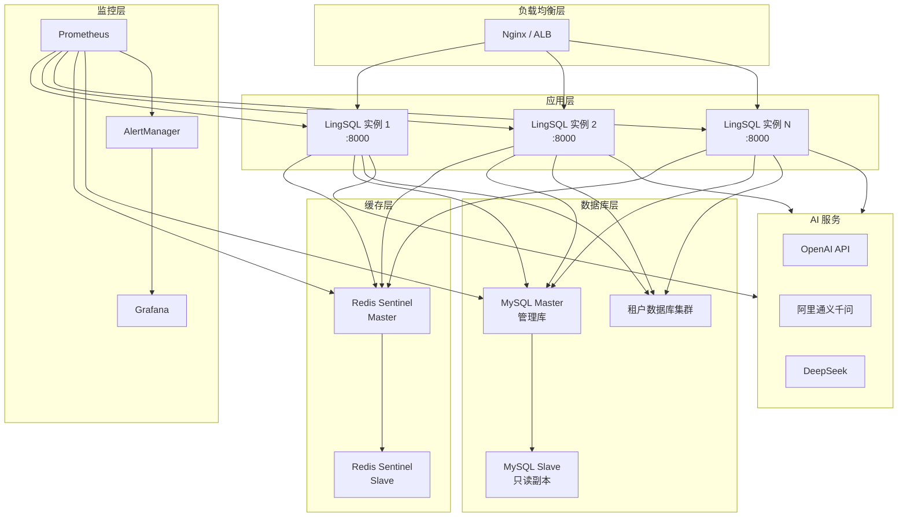
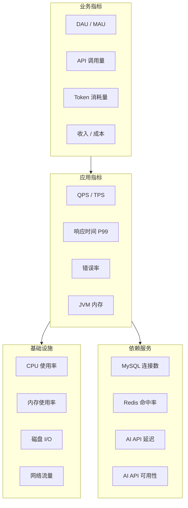
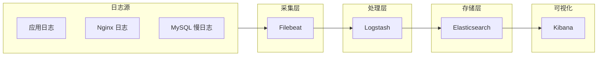
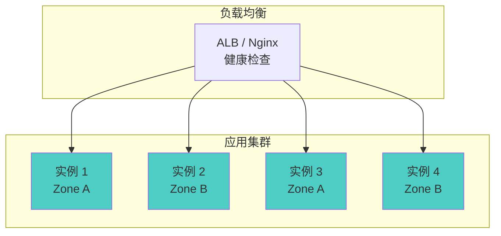
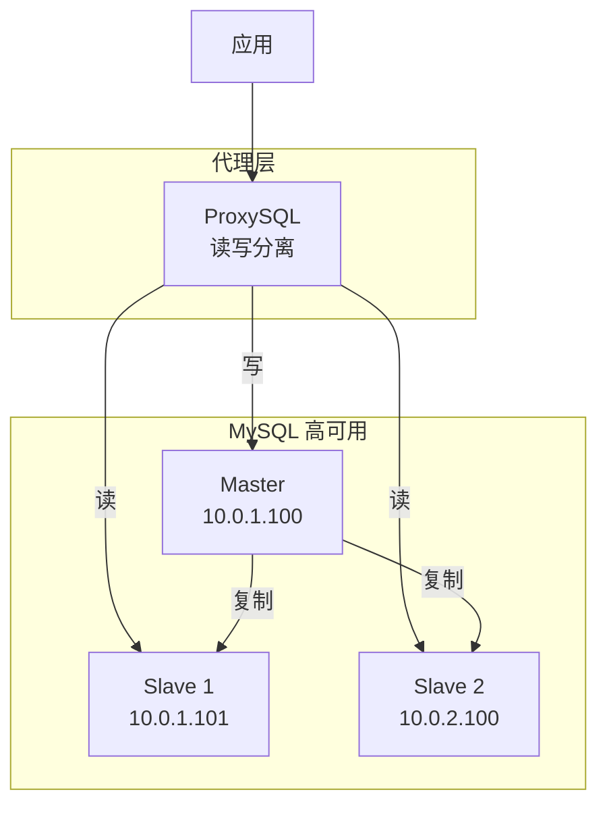
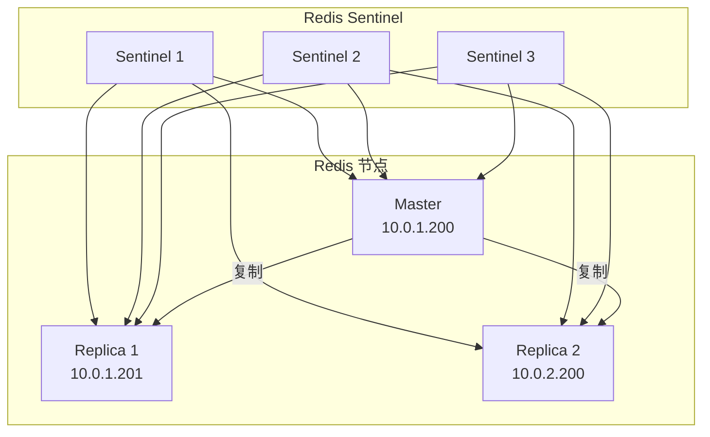
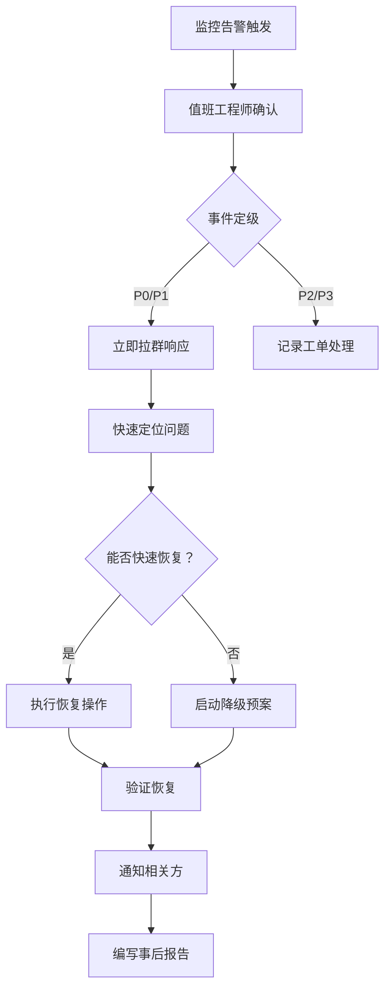
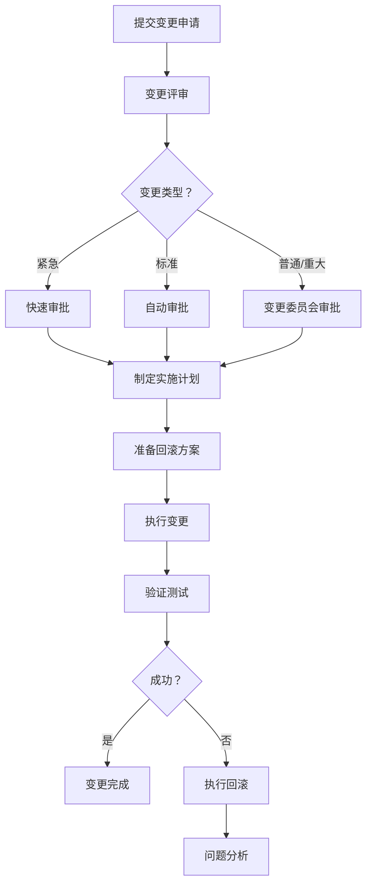
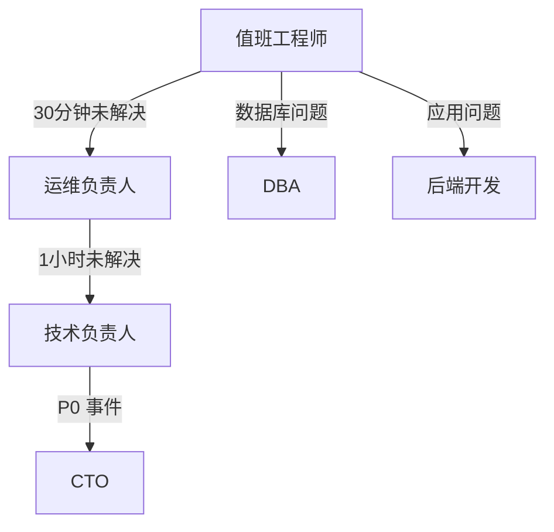

# LingSQL Engine SaaS 运维与灾备手册

> **版本**: v1.0
> **更新日期**: 2026-01-29
> **文档状态**: 正式发布
> **适用对象**: 运维工程师、SRE、技术支持、值班人员

---

## 目录

1. [运维架构概览](#1-运维架构概览)
2. [监控告警体系](#2-监控告警体系)
3. [日志管理](#3-日志管理)
4. [备份与恢复策略](#4-备份与恢复策略)
5. [高可用架构](#5-高可用架构)
6. [应急响应流程](#6-应急响应流程)
7. [变更管理](#7-变更管理)
8. [容量规划](#8-容量规划)
9. [故障排查 Runbook](#9-故障排查-runbook)
10. [运维检查清单](#10-运维检查清单)
11. [值班与交接](#11-值班与交接)
12. [联系人与升级路径](#12-联系人与升级路径)

---

## 1. 运维架构概览

### 1.1 系统架构图



### 1.2 核心组件清单

| 组件 | 版本 | 端口 | 用途 |
|------|------|------|------|
| LingSQL Engine | latest | 8000 | 核心业务服务 |
| MySQL | 8.0+ | 3306 | 管理库 + 租户库 |
| Redis | 7.0+ | 6379 | 缓存 + 计费余额 |
| Nginx | 1.24+ | 80/443 | 负载均衡 + SSL |
| Prometheus | 2.45+ | 9090 | 监控采集 |
| Grafana | 10.0+ | 3000 | 监控可视化 |
| AlertManager | 0.26+ | 9093 | 告警管理 |

### 1.3 环境清单

| 环境 | 用途 | 访问地址 | 数据库 |
|------|------|----------|--------|
| DEV | 开发测试 | dev.lingsql.local | lingsql_dev |
| UAT | 用户验收 | uat.lingsql.local | lingsql_uat |
| PROD | 生产环境 | api.lingsql.com | lingsql_prod |

---

## 2. 监控告警体系

### 2.1 监控指标分层



### 2.2 核心监控指标

| 指标 | 采集方式 | 告警阈值 | 说明 |
|------|----------|----------|------|
| **应用层** |
| `http_requests_total` | Prometheus | - | 请求总量 |
| `http_request_duration_seconds` | Prometheus | P99 > 3s | 响应延迟 |
| `http_requests_errors_total` | Prometheus | 错误率 > 1% | 错误请求 |
| `jvm_memory_used_bytes` | Micrometer | > 80% | JVM 内存 |
| `jvm_threads_live` | Micrometer | > 500 | 活跃线程 |
| **数据库层** |
| `mysql_connections` | mysqld_exporter | > 80% | 连接池使用 |
| `mysql_slow_queries` | mysqld_exporter | > 10/min | 慢查询 |
| `mysql_replication_lag` | mysqld_exporter | > 10s | 主从延迟 |
| **缓存层** |
| `redis_connected_clients` | redis_exporter | > 1000 | 连接数 |
| `redis_memory_used_bytes` | redis_exporter | > 80% | 内存使用 |
| `redis_keyspace_hits_ratio` | redis_exporter | < 90% | 命中率 |
| **业务层** |
| `billing_charge_total` | 自定义 | - | 计费次数 |
| `billing_balance_low` | 自定义 | < 1000点 | 低余额租户 |
| `billing_ledger_pending` | 自定义 | > 1000 | 待结算事件 |

### 2.3 告警规则配置

**Prometheus AlertManager 配置示例**：

```yaml
groups:
  - name: lingsql-alerts
    rules:
      # P1 紧急告警
      - alert: HighErrorRate
        expr: rate(http_requests_errors_total[5m]) / rate(http_requests_total[5m]) > 0.01
        for: 5m
        labels:
          severity: critical
        annotations:
          summary: "高错误率告警"
          description: "错误率超过 1%，当前值: {{ $value }}"

      - alert: ServiceDown
        expr: up{job="lingsql"} == 0
        for: 1m
        labels:
          severity: critical
        annotations:
          summary: "服务不可用"
          description: "LingSQL 实例 {{ $labels.instance }} 已下线"

      # P2 重要告警
      - alert: HighLatency
        expr: histogram_quantile(0.99, rate(http_request_duration_seconds_bucket[5m])) > 3
        for: 10m
        labels:
          severity: warning
        annotations:
          summary: "响应延迟过高"
          description: "P99 延迟超过 3 秒"

      - alert: BillingLedgerBacklog
        expr: billing_ledger_pending_count > 1000
        for: 15m
        labels:
          severity: warning
        annotations:
          summary: "计费账本积压"
          description: "待结算事件超过 1000 条"

      # P3 一般告警
      - alert: HighMemoryUsage
        expr: jvm_memory_used_bytes / jvm_memory_max_bytes > 0.8
        for: 30m
        labels:
          severity: info
        annotations:
          summary: "JVM 内存使用率高"
          description: "内存使用超过 80%"
```

### 2.4 告警通知渠道

| 级别 | 通知方式 | 响应时间 | 升级路径 |
|------|----------|----------|----------|
| P0 紧急 | 电话 + 短信 + 钉钉 | 15 分钟 | 值班 → 技术负责人 → CTO |
| P1 严重 | 短信 + 钉钉 | 30 分钟 | 值班 → 技术负责人 |
| P2 重要 | 钉钉 + 邮件 | 4 小时 | 值班工程师 |
| P3 一般 | 邮件 | 24 小时 | 白班处理 |

### 2.5 Grafana 仪表盘

**推荐仪表盘**：

| 仪表盘 | 内容 | 刷新频率 |
|--------|------|----------|
| LingSQL Overview | QPS、延迟、错误率、JVM | 10s |
| MySQL Dashboard | 连接数、QPS、慢查询、复制 | 30s |
| Redis Dashboard | 内存、命中率、连接数、命令 | 10s |
| Billing Dashboard | 计费量、余额、账本状态 | 1m |
| Tenant Health | 租户活跃度、调用量分布 | 5m |

---

## 3. 日志管理

### 3.1 日志分类

| 日志类型 | 文件/位置 | 保留期 | 用途 |
|----------|-----------|--------|------|
| 应用日志 | `/var/log/lingsql/app.log` | 30 天 | 业务逻辑日志 |
| 访问日志 | `/var/log/lingsql/access.log` | 90 天 | HTTP 请求日志 |
| 错误日志 | `/var/log/lingsql/error.log` | 90 天 | 异常堆栈 |
| SQL 审计日志 | MySQL 表 | 按套餐 | SQL 执行记录 |
| 安全日志 | `/var/log/lingsql/security.log` | 180 天 | 登录、权限 |

### 3.2 日志格式

**应用日志格式（JSON）**：

```json
{
  "timestamp": "2026-01-29T10:30:00.123Z",
  "level": "INFO",
  "logger": "com.lingsql.chat.ChatService",
  "thread": "virtual-thread-1",
  "traceId": "abc123def456",
  "tenantId": "tenant_001",
  "userId": 12345,
  "message": "Chat request processed",
  "duration": 1234,
  "tokenCount": 500
}
```

**访问日志格式**：

```
$remote_addr - $remote_user [$time_local] "$request" $status $body_bytes_sent "$http_referer" "$http_user_agent" $request_time $upstream_response_time
```

### 3.3 日志采集架构



### 3.4 日志查询示例

**Kibana 常用查询**：

```
# 查询特定租户的错误日志
tenantId:"tenant_001" AND level:"ERROR"

# 查询慢请求（>3秒）
duration:>3000

# 查询特定用户的操作
userId:12345 AND @timestamp:[now-1h TO now]

# 查询 SQL 执行日志
logger:"SqlExecutor" AND tokenCount:>1000
```

---

## 4. 备份与恢复策略

### 4.1 备份策略矩阵

| 数据类型 | 备份方式 | 频率 | 保留期 | RTO | RPO |
|----------|----------|------|--------|-----|-----|
| MySQL 管理库 | 全量 + Binlog | 每日全量 + 实时 | 30 天 | 4h | 5min |
| MySQL 租户库 | 全量 + Binlog | 每日全量 + 实时 | 30 天 | 4h | 5min |
| Redis 缓存 | RDB + AOF | 每小时 RDB | 7 天 | 1h | 1h |
| 配置文件 | Git 版本控制 | 每次变更 | 永久 | 15min | 0 |
| 日志文件 | 归档压缩 | 每日 | 按类型 | - | - |

### 4.2 MySQL 备份脚本

```bash
#!/bin/bash
# mysql_backup.sh - MySQL 全量备份脚本

set -e

# 配置
BACKUP_DIR="/data/backup/mysql"
MYSQL_HOST="127.0.0.1"
MYSQL_USER="backup"
MYSQL_PASS="${MYSQL_BACKUP_PASSWORD}"
DATABASES="lingsql_engine_db"
RETENTION_DAYS=30

# 创建备份目录
DATE=$(date +%Y%m%d_%H%M%S)
BACKUP_PATH="${BACKUP_DIR}/${DATE}"
mkdir -p "${BACKUP_PATH}"

# 执行备份
for DB in ${DATABASES}; do
  echo "Backing up database: ${DB}"
  mysqldump -h ${MYSQL_HOST} -u ${MYSQL_USER} -p${MYSQL_PASS} \
    --single-transaction \
    --routines \
    --triggers \
    --events \
    ${DB} | gzip > "${BACKUP_PATH}/${DB}.sql.gz"
done

# 备份 Binlog 位置
mysql -h ${MYSQL_HOST} -u ${MYSQL_USER} -p${MYSQL_PASS} \
  -e "SHOW MASTER STATUS\G" > "${BACKUP_PATH}/binlog_position.txt"

# 清理过期备份
find ${BACKUP_DIR} -type d -mtime +${RETENTION_DAYS} -exec rm -rf {} \;

# 验证备份
if [ -f "${BACKUP_PATH}/${DATABASES}.sql.gz" ]; then
  SIZE=$(ls -lh "${BACKUP_PATH}/${DATABASES}.sql.gz" | awk '{print $5}')
  echo "Backup completed: ${BACKUP_PATH}/${DATABASES}.sql.gz (${SIZE})"
else
  echo "Backup failed!"
  exit 1
fi
```

### 4.3 恢复流程

#### 4.3.1 MySQL 全量恢复

```bash
#!/bin/bash
# mysql_restore.sh - MySQL 恢复脚本

BACKUP_FILE=$1
TARGET_DB=$2

if [ -z "${BACKUP_FILE}" ] || [ -z "${TARGET_DB}" ]; then
  echo "Usage: $0 <backup_file.sql.gz> <target_database>"
  exit 1
fi

# 解压并恢复
echo "Restoring ${BACKUP_FILE} to ${TARGET_DB}..."
gunzip -c ${BACKUP_FILE} | mysql -h ${MYSQL_HOST} -u ${MYSQL_USER} -p${MYSQL_PASS} ${TARGET_DB}

echo "Restore completed."
```

#### 4.3.2 Redis 缓存重建

```bash
# 1. 停止应用写入
# 2. 恢复 RDB 文件
cp /data/backup/redis/dump.rdb /var/lib/redis/dump.rdb
chown redis:redis /var/lib/redis/dump.rdb

# 3. 重启 Redis
systemctl restart redis

# 4. 验证数据
redis-cli info keyspace

# 5. 重建计费余额缓存（从 MySQL 同步）
# 应用会在首次访问时自动从 DB 加载余额到 Redis
```

### 4.4 灾难恢复演练

| 演练场景 | 频率 | 参与人员 | 预期时间 |
|----------|------|----------|----------|
| MySQL 主库故障切换 | 季度 | DBA + 运维 | 30 分钟 |
| 全量数据恢复 | 半年 | 运维团队 | 4 小时 |
| 跨机房切换 | 年度 | 全团队 | 2 小时 |
| Redis 缓存丢失恢复 | 季度 | 运维 | 1 小时 |

---

## 5. 高可用架构

### 5.1 应用层高可用



**健康检查配置**：

```nginx
upstream lingsql {
    server 10.0.1.10:8000 weight=1 max_fails=3 fail_timeout=30s;
    server 10.0.1.11:8000 weight=1 max_fails=3 fail_timeout=30s;
    server 10.0.2.10:8000 weight=1 max_fails=3 fail_timeout=30s;
    server 10.0.2.11:8000 weight=1 max_fails=3 fail_timeout=30s;

    keepalive 32;
}

server {
    location /health {
        proxy_pass http://lingsql;
        proxy_connect_timeout 5s;
        proxy_read_timeout 10s;
    }
}
```

### 5.2 数据库高可用



### 5.3 Redis 高可用



**Sentinel 配置**：

```conf
# sentinel.conf
sentinel monitor lingsql-redis 10.0.1.200 6379 2
sentinel down-after-milliseconds lingsql-redis 5000
sentinel failover-timeout lingsql-redis 60000
sentinel parallel-syncs lingsql-redis 1
```

---

## 6. 应急响应流程

### 6.1 事件分级

| 级别 | 定义 | 示例 | 响应时间 |
|------|------|------|----------|
| **P0** | 全站不可用 | 所有 API 返回 5xx | 15 分钟 |
| **P1** | 核心功能不可用 | 聊天接口不可用 | 30 分钟 |
| **P2** | 功能降级 | 响应延迟高 | 4 小时 |
| **P3** | 轻微问题 | 单租户问题 | 24 小时 |

### 6.2 应急响应流程



### 6.3 降级预案

| 场景 | 降级措施 | 影响 |
|------|----------|------|
| AI 服务不可用 | 切换备用模型供应商 | 可能影响生成质量 |
| MySQL 主库故障 | 提升 Slave 为 Master | 短暂写入中断 |
| Redis 不可用 | 降级到 DB 直接操作 | 性能下降 50% |
| 网络分区 | 切换流量到备用机房 | 部分用户延迟增加 |

### 6.4 常用应急命令

```bash
# 快速重启应用
systemctl restart lingsql

# 查看应用日志
tail -f /var/log/lingsql/app.log | grep -i error

# 检查 MySQL 连接
mysql -e "SHOW PROCESSLIST;" | wc -l

# 检查 Redis 状态
redis-cli info | grep -E "connected_clients|used_memory|keyspace"

# 检查磁盘空间
df -h

# 检查系统负载
top -b -n 1 | head -20

# 快速清理日志（紧急情况）
find /var/log/lingsql -name "*.log" -mtime +7 -delete

# 强制 GC（应急）
jcmd $(pgrep -f lingsql) GC.run
```

---

## 7. 变更管理

### 7.1 变更分类

| 类型 | 定义 | 审批要求 | 窗口期 |
|------|------|----------|--------|
| 紧急变更 | 修复 P0/P1 故障 | 事后补审 | 随时 |
| 标准变更 | 预定义的常规操作 | 自动审批 | 工作日 |
| 普通变更 | 配置修改、版本更新 | 变更委员会 | 维护窗口 |
| 重大变更 | 架构调整、数据迁移 | 技术委员会 | 维护窗口 |

### 7.2 变更流程



### 7.3 发布检查清单

**发布前**：
- [ ] 代码审查已通过
- [ ] 测试环境验证通过
- [ ] 回滚方案已准备
- [ ] 数据库变更脚本已验证
- [ ] 配置变更已确认
- [ ] 相关人员已通知

**发布中**：
- [ ] 备份当前版本
- [ ] 按步骤执行变更
- [ ] 观察监控指标
- [ ] 记录操作日志

**发布后**：
- [ ] 功能验证通过
- [ ] 监控指标正常
- [ ] 更新变更记录
- [ ] 通知相关方

---

## 8. 容量规划

### 8.1 资源规格建议

| 规模 | 日活租户 | 日请求量 | 应用实例 | MySQL | Redis |
|------|----------|----------|----------|-------|-------|
| 小型 | <100 | <10万 | 2×2C4G | 1×4C8G | 1×2C4G |
| 中型 | 100-500 | 10-50万 | 4×4C8G | 2×8C16G | 2×4C8G |
| 大型 | 500-2000 | 50-200万 | 8×8C16G | 3×16C32G | 3×8C16G |
| 超大 | >2000 | >200万 | 16×8C16G | 集群 | 集群 |

### 8.2 扩容指标阈值

| 资源 | 扩容阈值 | 缩容阈值 |
|------|----------|----------|
| CPU | 持续 > 70% | 持续 < 30% |
| 内存 | 持续 > 80% | 持续 < 40% |
| 磁盘 | > 70% | - |
| 连接数 | > 80% | < 30% |
| QPS | 接近上限 80% | < 30% |

### 8.3 容量计算公式

```
应用实例数 = 峰值 QPS / (单实例 QPS × 0.7)
MySQL 连接数 = 应用实例数 × 单实例连接池 × 1.2
Redis 内存 = 活跃租户数 × 单租户缓存 × 1.5
```

---

## 9. 故障排查 Runbook

### 9.1 服务不可用

**症状**：所有 API 返回 502/503

**排查步骤**：

```bash
# 1. 检查应用进程
systemctl status lingsql
ps aux | grep java

# 2. 检查端口监听
netstat -tlnp | grep 8000

# 3. 检查应用日志
tail -100 /var/log/lingsql/app.log

# 4. 检查系统资源
free -h
df -h
top -b -n 1

# 5. 检查依赖服务
mysql -e "SELECT 1"
redis-cli ping

# 恢复操作
systemctl restart lingsql
```

### 9.2 响应延迟高

**症状**：P99 延迟 > 3s

**排查步骤**：

```bash
# 1. 检查 AI 服务延迟
curl -w "%{time_total}s" https://api.openai.com/v1/health

# 2. 检查 MySQL 慢查询
mysql -e "SHOW FULL PROCESSLIST"

# 3. 检查 JVM GC
jstat -gcutil $(pgrep -f lingsql) 1000 5

# 4. 检查线程状态
jstack $(pgrep -f lingsql) > /tmp/thread_dump.txt
grep -c "BLOCKED" /tmp/thread_dump.txt

# 5. 检查 Redis 延迟
redis-cli --latency

# 恢复操作
# - 增加应用实例
# - 切换 AI 服务供应商
# - 优化慢查询
```

### 9.3 计费账本积压

**症状**：`billing_ledger_pending_count > 1000`

**排查步骤**：

```bash
# 1. 检查积压数量
mysql -e "SELECT COUNT(*) FROM t_lingsql_engine_billing_ledger WHERE status = 0"

# 2. 检查结算任务
grep "settleLedger" /var/log/lingsql/app.log | tail -20

# 3. 检查失败事件
mysql -e "SELECT * FROM t_lingsql_engine_billing_ledger WHERE status = 2 ORDER BY create_time DESC LIMIT 10"

# 4. 手动触发结算
curl -X POST http://localhost:8000/actuator/scheduledtasks/trigger/settleLedger

# 恢复操作
# - 检查数据库连接
# - 清理失败事件
# - 重启应用
```

### 9.4 Redis 缓存不一致

**症状**：Redis 余额与 DB 不一致

**排查步骤**：

```bash
# 1. 对比余额
TENANT_ID="tenant_001"

# Redis 余额
redis-cli GET lingsql:billing:balance:${TENANT_ID}

# DB 余额
mysql -e "SELECT quota_balance FROM t_lingsql_engine_tenant WHERE tenant_id='${TENANT_ID}'"

# 2. 检查结算状态
mysql -e "SELECT status, COUNT(*) FROM t_lingsql_engine_billing_ledger WHERE tenant_id='${TENANT_ID}' GROUP BY status"

# 3. 重置缓存（以 DB 为准）
DB_BALANCE=$(mysql -N -e "SELECT quota_balance FROM t_lingsql_engine_tenant WHERE tenant_id='${TENANT_ID}'")
redis-cli SET lingsql:billing:balance:${TENANT_ID} ${DB_BALANCE}
```

---

## 10. 运维检查清单

### 10.1 每日检查

| 检查项 | 命令/方法 | 预期结果 |
|--------|-----------|----------|
| 服务状态 | `systemctl status lingsql` | active (running) |
| 错误日志 | `grep -c ERROR /var/log/lingsql/app.log` | < 100 |
| 磁盘空间 | `df -h` | < 70% |
| MySQL 复制 | `SHOW SLAVE STATUS\G` | Seconds_Behind_Master < 10 |
| Redis 内存 | `redis-cli info memory` | used_memory < 80% |
| 计费积压 | `SELECT COUNT(*) WHERE status=0` | < 100 |

### 10.2 每周检查

| 检查项 | 方法 | 预期结果 |
|--------|------|----------|
| 备份验证 | 恢复测试 | 数据完整 |
| 慢查询分析 | MySQL 慢日志 | 无新增慢查询 |
| 安全更新 | `yum check-update` | 无高危漏洞 |
| SSL 证书 | 检查过期时间 | > 30 天 |
| 容量趋势 | Grafana 图表 | 无异常增长 |

### 10.3 每月检查

| 检查项 | 方法 | 预期结果 |
|--------|------|----------|
| 灾备演练 | 故障切换测试 | 切换成功 |
| 权限审查 | 账号清理 | 无僵尸账号 |
| 成本分析 | 云账单审查 | 无异常支出 |
| 性能基准 | 压测对比 | 性能稳定 |

---

## 11. 值班与交接

### 11.1 值班安排

| 班次 | 时间 | 职责 |
|------|------|------|
| 白班 | 09:00-18:00 | 日常运维 + 告警响应 |
| 晚班 | 18:00-09:00 | 告警响应 + 紧急处理 |
| 周末 | 全天 | 告警响应 |

### 11.2 交接内容

**交接模板**：

```markdown
## 值班交接 - 2026-01-29

### 当前状态
- [ ] 所有服务正常
- [ ] 无未处理告警
- [ ] 无进行中的变更

### 待处理事项
1. [P3] tenant_xxx 反馈查询慢 - 已创建工单
2. 计划变更：明日 10:00 版本发布

### 今日事件
- 10:30 P2告警：响应延迟高，已恢复
- 15:00 租户 xxx 充值 10万点

### 注意事项
- AI 服务供应商 A 今晚有维护窗口
- 明日有重大版本发布，需提前准备

### 交接人
- 交接人：张三
- 接班人：李四
- 交接时间：2026-01-29 18:00
```

---

## 12. 联系人与升级路径

### 12.1 联系人清单

| 角色 | 姓名 | 电话 | 职责 |
|------|------|------|------|
| 运维负责人 | 张三 | 138xxxx | 运维决策 |
| DBA | 李四 | 139xxxx | 数据库问题 |
| 后端开发 | 王五 | 137xxxx | 应用问题 |
| 技术负责人 | 赵六 | 136xxxx | P0/P1 升级 |
| CTO | 钱七 | 135xxxx | 重大事件 |

### 12.2 升级路径



### 12.3 外部支持

| 供应商 | 服务 | 支持电话 | SLA |
|--------|------|----------|-----|
| 阿里云 | 云服务 | 400-xxx | 7×24 |
| OpenAI | AI API | 工单 | 48h |
| MySQL | 数据库 | 社区 | - |

---

## 文档变更历史

| 版本 | 日期 | 作者 | 变更说明 |
|------|------|------|----------|
| v1.0 | 2026-01-29 | LingSQL Team | 初始版本 |

---

> **重要提示**：本手册中的命令和脚本需要根据实际环境调整。执行任何变更操作前，请确保已有回滚方案。
