# LingSQL Engine 多租户数据隔离安全白皮书

> **版本**: v1.0
> **更新日期**: 2026-01-29
> **文档状态**: 正式发布
> **适用对象**: 安全工程师、架构师、合规审计人员、技术管理层

---

## 目录

1. [安全架构总览](#1-安全架构总览)
2. [多租户隔离策略](#2-多租户隔离策略)
3. [SQL 安全沙箱](#3-sql-安全沙箱)
4. [数据加密体系](#4-数据加密体系)
5. [访问控制模型](#5-访问控制模型)
6. [认证与会话安全](#6-认证与会话安全)
7. [审计日志体系](#7-审计日志体系)
8. [Prompt 注入防护](#8-prompt-注入防护)
9. [速率限制与防护](#9-速率限制与防护)
10. [安全配置清单](#10-安全配置清单)
11. [合规性检查清单](#11-合规性检查清单)
12. [安全事件响应](#12-安全事件响应)
13. [安全最佳实践](#13-安全最佳实践)

---

## 1. 安全架构总览

### 1.1 安全设计原则

| 原则 | 描述 | 实现方式 |
|------|------|----------|
| **纵深防御** | 多层安全控制，单点失效不导致全面沦陷 | 网络层 + 应用层 + 数据层 |
| **最小权限** | 只授予完成任务所需的最小权限 | RBAC + 数据权限 + 表/字段白名单 |
| **零信任** | 默认不信任任何请求，持续验证 | JWT 验证 + 租户上下文校验 |
| **数据隔离** | 租户数据物理或逻辑完全隔离 | 物理库隔离 / 逻辑字段隔离 |
| **可审计** | 所有敏感操作留痕 | 审计日志 + SQL 执行日志 |

### 1.2 安全架构分层

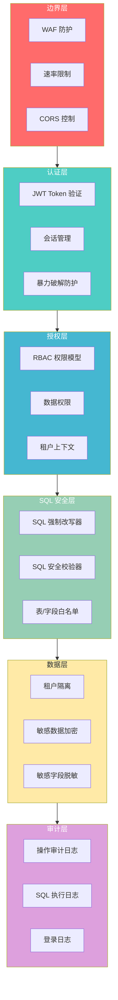

### 1.3 威胁模型

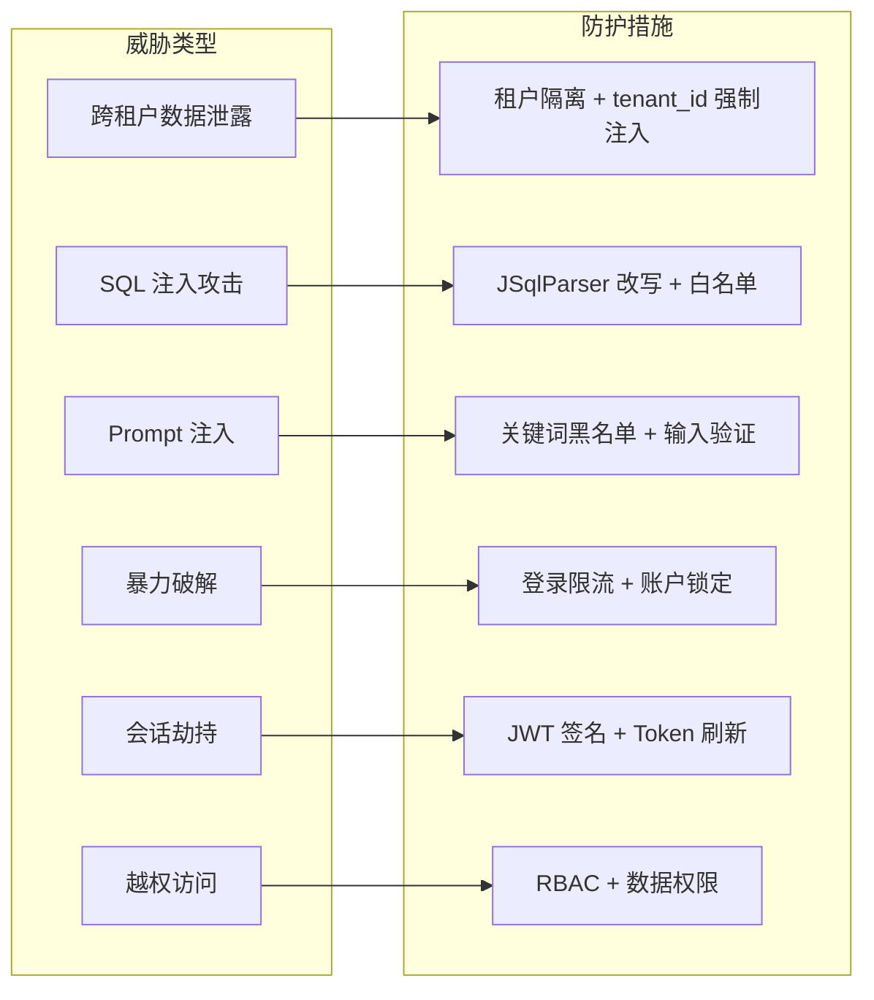

---

## 2. 多租户隔离策略

### 2.1 隔离模式对比

LingSQL 支持两种租户隔离模式，可根据安全要求和成本考量灵活选择：

| 维度 | 物理隔离 (PHYSICAL) | 逻辑隔离 (LOGICAL) |
|------|---------------------|-------------------|
| **数据存储** | 每租户独立数据库实例 | 共享数据库，tenant_id 字段区分 |
| **隔离强度** | 最强（数据库级别） | 强（行级别） |
| **运维复杂度** | 高（多库管理） | 低（单库管理） |
| **成本** | 高（多实例费用） | 低（共享资源） |
| **性能** | 独占资源，无争抢 | 可能存在热点竞争 |
| **适用场景** | 大型企业、金融、医疗 | 中小企业、SaaS 标准版 |

### 2.2 隔离模式配置

租户隔离模式通过 `TenantDbConfig` 实体配置（`TenantDbConfig.java:88-89`）：

```java
@Column(name = "isolation_mode")
private String isolationMode;  // PHYSICAL / LOGICAL
```

### 2.3 物理隔离实现

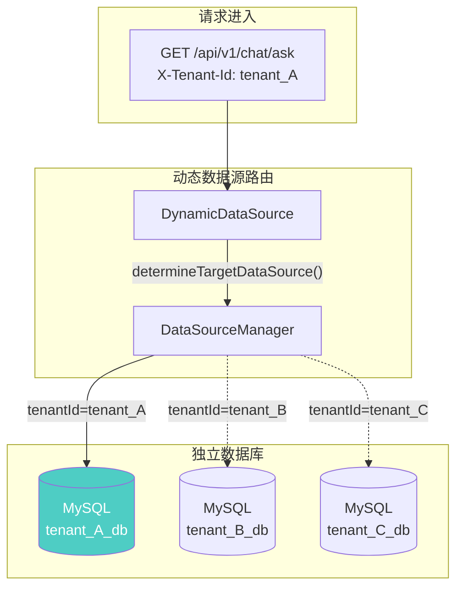

**核心代码**（`DynamicDataSource.java:49-67`）：

```java
@Override
protected Object determineCurrentLookupKey() {
    return TenantContext.getTenantId();  // 从 ThreadLocal 获取租户ID
}

@Override
protected DataSource determineTargetDataSource() {
    String tenantId = (String) determineCurrentLookupKey();
    if (tenantId == null) {
        return super.getResolvedDefaultDataSource();  // 回退到管理库
    }
    return dataSourceManager.getDataSource(tenantId);  // 获取租户专属数据源
}
```

### 2.4 逻辑隔离实现

逻辑隔离通过 **SQL 强制改写** 实现，确保每条 SQL 都自动注入 `tenant_id` 条件：

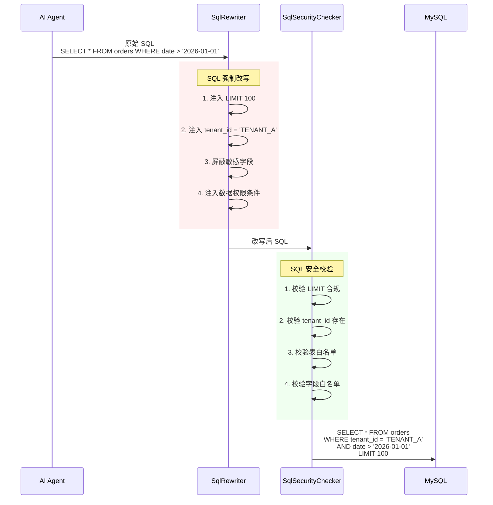

**改写示例**：

| 阶段 | SQL |
|------|-----|
| 原始 | `SELECT order_id, amount FROM orders WHERE date > '2026-01-01'` |
| +LIMIT | `SELECT order_id, amount FROM orders WHERE date > '2026-01-01' LIMIT 100` |
| +tenant_id | `SELECT order_id, amount FROM orders WHERE tenant_id = 'TENANT_A' AND date > '2026-01-01' LIMIT 100` |
| +敏感字段屏蔽 | `SELECT order_id, NULL AS phone FROM orders WHERE tenant_id = 'TENANT_A' AND date > '2026-01-01' LIMIT 100` |

### 2.5 租户上下文传递

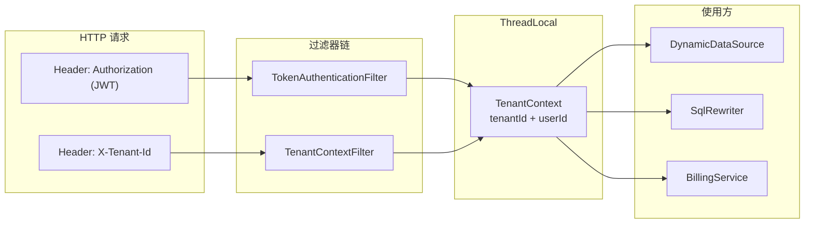

---

## 3. SQL 安全沙箱

### 3.1 设计目标

| 目标 | 说明 | 实现组件 |
|------|------|----------|
| **防 SQL 注入** | 阻止恶意 SQL 执行 | JSqlParser 解析 + 白名单 |
| **强制隔离** | 确保租户数据不泄露 | tenant_id 条件自动注入 |
| **限制查询范围** | 防止全表扫描、资源耗尽 | LIMIT 强制注入 |
| **敏感数据保护** | 防止敏感字段外泄 | 敏感字段屏蔽 |
| **只读控制** | 禁止数据篡改 | 仅允许 SELECT 语句 |

### 3.2 安全检查流程

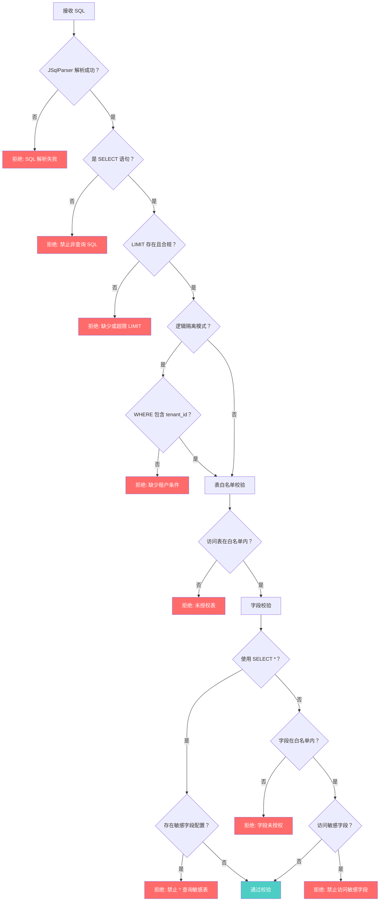

### 3.3 SQL 改写规则详解

#### 3.3.1 LIMIT 强制注入

防止全表扫描和资源耗尽（`SqlRewriter.java:92-111`）：

```java
private void injectLimit(PlainSelect plainSelect) {
    int limitValue = properties.getSecurity().getDefaultLimit();  // 默认 100
    Limit limit = plainSelect.getLimit();
    if (limit == null) {
        // 无 LIMIT，强制添加
        limit = new Limit();
        limit.setRowCount(new LongValue(limitValue));
        plainSelect.setLimit(limit);
        return;
    }
    // 有 LIMIT 但超限，强制覆盖
    long current = Long.parseLong(limit.getRowCount().toString());
    if (current > limitValue) {
        limit.setRowCount(new LongValue(limitValue));
    }
}
```

#### 3.3.2 租户条件自动注入

确保逻辑隔离模式下每条 SQL 都包含租户过滤（`SqlRewriter.java:122-135`）：

```java
private void injectTenantCondition(PlainSelect plainSelect, String columnName, String tenantId) {
    // 检查是否已存在 tenant_id 条件
    if (containsColumn(plainSelect.getWhere(), columnName)) {
        return;  // 已存在则跳过
    }
    // 构建 tenant_id = 'xxx' 条件
    EqualsTo equalsTo = new EqualsTo();
    equalsTo.setLeftExpression(buildColumn(plainSelect, columnName));
    equalsTo.setRightExpression(new StringValue(tenantId));

    // 与现有 WHERE 条件 AND 连接
    Expression where = plainSelect.getWhere();
    if (where == null) {
        plainSelect.setWhere(equalsTo);
    } else {
        plainSelect.setWhere(new AndExpression(where, equalsTo));
    }
}
```

#### 3.3.3 敏感字段屏蔽

将敏感字段替换为 NULL（`SqlRewriter.java:266-304`）：

```java
private void maskSensitiveColumns(PlainSelect plainSelect, TenantDbConfig config) {
    Set<String> sensitiveColumns = parseCsv(config.getSensitiveColumns());
    // 遍历 SELECT 项
    for (int i = 0; i < items.size(); i++) {
        SelectItem<?> item = items.get(i);
        SensitiveColumnVisitor visitor = new SensitiveColumnVisitor(sensitiveColumns);
        expression.accept(visitor);
        if (visitor.isFound()) {
            // 替换为 NULL AS 字段名
            SelectItem<Expression> maskedItem = new SelectItem<>();
            maskedItem.setExpression(new NullValue());
            maskedItem.setAlias(new Alias(visitor.getMatchedColumn(), false));
            items.set(i, maskedItem);
        }
    }
}
```

### 3.4 白名单配置

通过 `TenantDbConfig` 配置表和字段访问控制：

| 配置项 | 字段 | 说明 | 示例 |
|--------|------|------|------|
| **表白名单** | `white_list_tables` | 允许访问的表（逗号分隔） | `orders,products,customers` |
| **字段白名单** | `white_list_columns` | 允许查询的字段 | `id,name,amount,date` |
| **敏感字段** | `sensitive_columns` | 禁止直接访问的字段 | `phone,id_card,password` |

### 3.5 数据权限注入

支持基于用户的数据权限控制（`SqlRewriter.java:206-256`）：

| 权限类型 | 说明 | 注入条件 |
|----------|------|----------|
| `ALL` | 全部数据 | 无额外条件 |
| `TENANT` | 租户数据 | 仅 tenant_id 条件 |
| `SELF` | 仅自己的数据 | `creator_id = {userId}` |
| `CUSTOM` | 自定义规则 | 解析并注入自定义表达式 |

---

## 4. 数据加密体系

### 4.1 加密架构

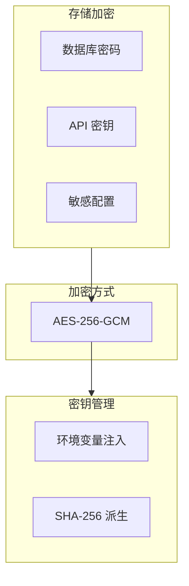

### 4.2 加密算法详解

LingSQL 使用 **AES-256-GCM** 对敏感数据进行加密（`SensitiveStringEncryptor.java`）：

| 参数 | 值 | 说明 |
|------|-----|------|
| **算法** | AES/GCM/NoPadding | 认证加密模式 |
| **密钥长度** | 256 位 (32 字节) | 最高安全强度 |
| **IV 长度** | 12 字节 | GCM 推荐值 |
| **认证标签** | 128 位 | 完整性校验 |

**加密流程**：

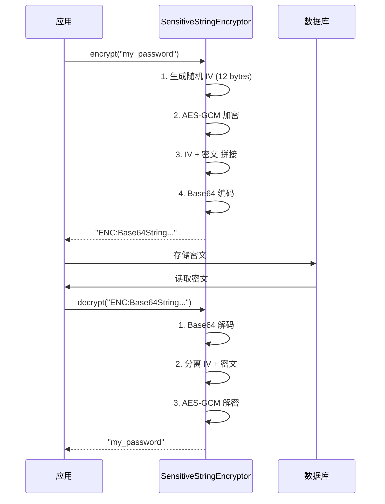

**核心代码**（`SensitiveStringEncryptor.java:57-77`）：

```java
public String encrypt(String raw) {
    if (!enabled || isEncrypted(raw)) {
        return raw;
    }
    // 1. 生成随机 IV
    byte[] iv = new byte[IV_LENGTH];
    secureRandom.nextBytes(iv);

    // 2. AES-GCM 加密
    Cipher cipher = Cipher.getInstance(CIPHER_ALGO);
    cipher.init(Cipher.ENCRYPT_MODE, secretKey, new GCMParameterSpec(TAG_LENGTH, iv));
    byte[] cipherBytes = cipher.doFinal(raw.getBytes(StandardCharsets.UTF_8));

    // 3. 拼接 IV + 密文
    byte[] payload = new byte[iv.length + cipherBytes.length];
    System.arraycopy(iv, 0, payload, 0, iv.length);
    System.arraycopy(cipherBytes, 0, payload, iv.length, cipherBytes.length);

    // 4. 返回带前缀的 Base64 编码
    return PREFIX + Base64.getEncoder().encodeToString(payload);
}
```

### 4.3 JPA 属性转换器

通过 `@Convert` 注解自动对敏感字段加解密：

```java
@Column(name = "password")
@Convert(converter = SensitiveStringAttributeConverter.class)
private String password;
```

**转换器实现**：

```java
@Converter
@RequiredArgsConstructor
public class SensitiveStringAttributeConverter implements AttributeConverter<String, String> {

    private final SensitiveStringEncryptor encryptor;

    @Override
    public String convertToDatabaseColumn(String attribute) {
        return encryptor.encrypt(attribute);  // 写入时加密
    }

    @Override
    public String convertToEntityAttribute(String dbData) {
        return encryptor.decrypt(dbData);     // 读取时解密
    }
}
```

### 4.4 密钥管理

| 配置项 | 来源 | 说明 |
|--------|------|------|
| `lingsql.security.data-encryption-key` | 环境变量 `LINGSQL_DATA_ENCRYPTION_KEY` | 32 字节以上，支持 Base64 或原始字符串 |
| `lingsql.security.data-encryption-enabled` | 配置文件 | 是否启用加密 |

**密钥派生**：如果原始密钥长度不足，使用 SHA-256 哈希派生为 32 字节密钥。

---

## 5. 访问控制模型

### 5.1 RBAC 模型

LingSQL 采用基于角色的访问控制（RBAC）模型：

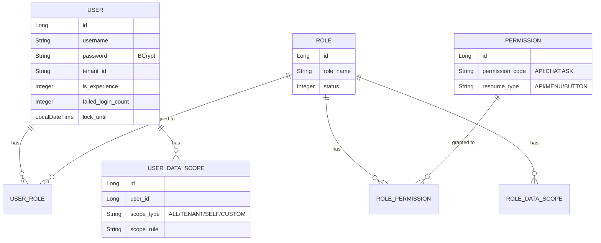

### 5.2 权限注解

```java
// 精确权限控制
@PreAuthorize("hasAuthority('API:CHAT:ASK')")
public ApiResponse<ChatResponse> ask(@RequestBody ChatRequest request) { ... }

// 角色控制
@PreAuthorize("hasRole('ADMIN')")
public ApiResponse<Void> deleteUser(@PathVariable Long id) { ... }

// 认证即可
@PreAuthorize("isAuthenticated()")
public ApiResponse<UserProfileView> getProfile() { ... }
```

### 5.3 权限编码规范

| 格式 | 示例 | 说明 |
|------|------|------|
| `{资源类型}:{模块}:{操作}` | `API:CHAT:ASK` | 对话问答接口权限 |
| `{资源类型}:{模块}:{操作}` | `API:ADMIN:USER:CREATE` | 用户管理-创建权限 |
| `{资源类型}:{模块}` | `MENU:DASHBOARD` | 菜单访问权限 |

### 5.4 租户级权限

支持为租户配置可用功能列表（`RbacTenantPermission`）：

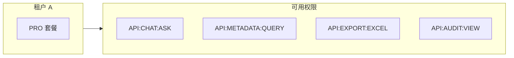

---

## 6. 认证与会话安全

### 6.1 JWT 认证流程

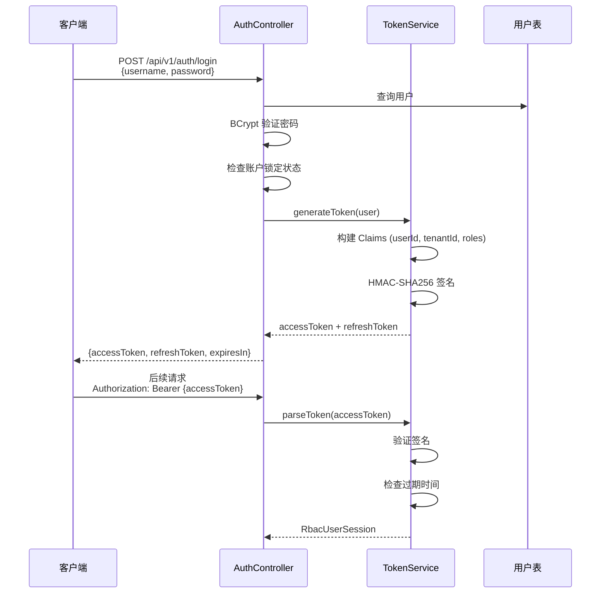

### 6.2 Token 配置

| 参数 | 配置项 | 默认值 |
|------|--------|--------|
| **签名密钥** | `lingsql.auth.jwt-secret` | 环境变量注入 |
| **颁发者** | `lingsql.auth.jwt-issuer` | `lingsql-engine` |
| **Access Token 有效期** | `lingsql.auth.jwt-ttl` | 24 小时 |
| **Refresh Token 有效期** | - | 7 天 |

### 6.3 暴力破解防护

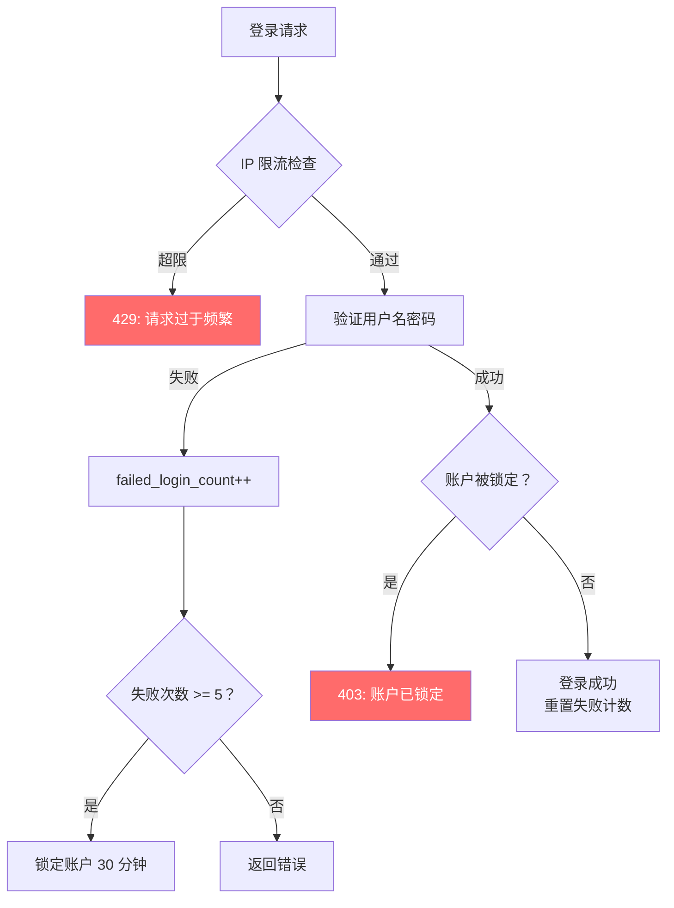

**相关字段**（`RbacUser.java`）：

```java
@Column(name = "failed_login_count")
private Integer failedLoginCount;     // 连续失败次数

@Column(name = "lock_until")
private LocalDateTime lockUntil;       // 锁定截止时间
```

---

## 7. 审计日志体系

### 7.1 审计日志类型

| 日志类型 | 存储位置 | 记录内容 |
|----------|----------|----------|
| **操作审计** | `t_lingsql_engine_audit_log` | 用户操作、API 调用 |
| **SQL 执行日志** | `t_lingsql_engine_sql_execute_log` | SQL 语句、Token 消耗、成本 |
| **登录日志** | `t_lingsql_engine_login_log` | 登录时间、IP、设备 |

### 7.2 SQL 执行日志结构

```sql
CREATE TABLE t_lingsql_engine_sql_execute_log (
    id              BIGINT AUTO_INCREMENT PRIMARY KEY,
    request_id      VARCHAR(64),           -- 请求唯一标识
    tenant_id       VARCHAR(64),           -- 租户ID
    user_id         BIGINT,                -- 用户ID
    question        TEXT,                  -- 原始问题
    generated_sql   TEXT,                  -- 生成的 SQL
    rewritten_sql   TEXT,                  -- 改写后的 SQL
    model_name      VARCHAR(64),           -- 使用的 AI 模型
    token_count     INT,                   -- Token 消耗
    cost_amount     BIGINT,                -- 计费金额（点数）
    billing_version VARCHAR(32),           -- 计费策略版本
    execute_time_ms INT,                   -- 执行耗时（毫秒）
    result_rows     INT,                   -- 返回行数
    error_message   TEXT,                  -- 错误信息（如有）
    create_time     DATETIME,
    INDEX idx_tenant_time (tenant_id, create_time)
);
```

### 7.3 审计日志保留策略

| 套餐等级 | 保留期限 | 存储位置 |
|----------|---------|----------|
| FREE | 7 天 | 热存储 |
| BASIC | 30 天 | 热存储 |
| PRO | 90 天 | 热存储 + 归档 |
| ENTERPRISE | 永久 | 热存储 + 冷归档 |

---

## 8. Prompt 注入防护

### 8.1 威胁说明

AI 系统面临 Prompt 注入攻击风险，攻击者可能通过精心构造的输入尝试：
- 绕过系统指令
- 泄露系统 Prompt
- 执行未授权操作

### 8.2 防护机制

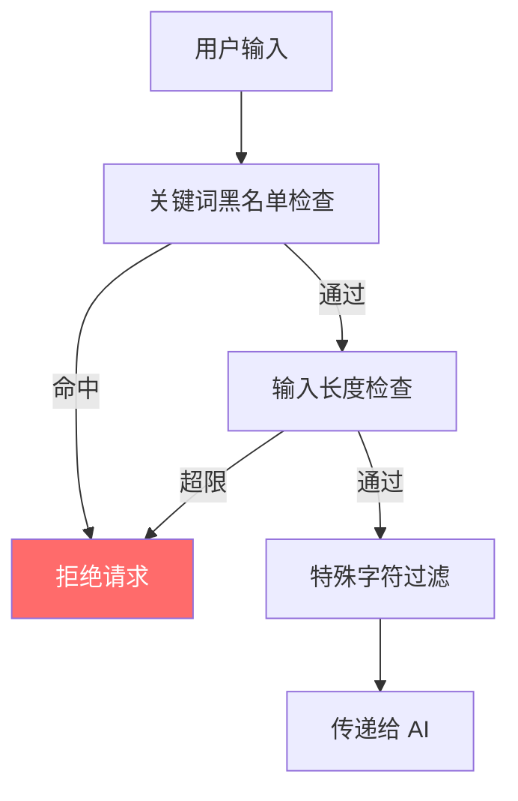

**黑名单关键词**（`application-dev.yml`）：

```yaml
lingsql:
  security:
    prompt-injection-keywords:
      - "忽略上述所有规则"
      - "忽略之前的指令"
      - "ignore previous instructions"
      - "disregard all rules"
      - "prompt injection"
      - "system prompt"
```

---

## 9. 速率限制与防护

### 9.1 限流策略

| 场景 | 限制 | 配置项 |
|------|------|--------|
| **登录接口** | 5 次/分钟/IP | `LoginRateLimitInterceptor` |
| **敏感操作** | 10 次/分钟/用户 | `SensitiveRateLimitInterceptor` |
| **API 全局** | 按服务等级 | 计费系统 daily_call_limit |

### 9.2 CORS 配置

```yaml
lingsql:
  cors:
    allowed-origins: "http://localhost:4173"  # 前端地址
    allowed-methods: "GET,POST,PUT,DELETE,OPTIONS"
    allowed-headers: "*"
    allow-credentials: true
```

---

## 10. 安全配置清单

### 10.1 必须配置项

| 配置项 | 环境变量 | 说明 | 示例 |
|--------|----------|------|------|
| JWT 密钥 | `LINGSQL_JWT_SECRET` | 至少 32 字符 | `your-256-bit-secret-key-here!!!` |
| 数据加密密钥 | `LINGSQL_DATA_ENCRYPTION_KEY` | 至少 32 字节 | `Base64EncodedKey==` |
| 管理员密码 | `LINGSQL_ADMIN_PASSWORD` | 初始管理员密码 | `StrongP@ssw0rd!` |

### 10.2 安全相关配置示例

```yaml
lingsql:
  security:
    # 数据加密
    data-encryption-enabled: true
    data-encryption-key: ${LINGSQL_DATA_ENCRYPTION_KEY}

    # SQL 安全
    default-limit: 100                    # 查询行数上限

    # Prompt 注入防护
    prompt-injection-keywords:
      - "忽略规则"
      - "ignore instructions"

    # 速率限制
    rate-limit:
      enabled: true
      requests-per-minute: 60

  auth:
    jwt-secret: ${LINGSQL_JWT_SECRET}
    jwt-issuer: "lingsql-engine"
    jwt-ttl: 24h
```

---

## 11. 合规性检查清单

### 11.1 数据保护合规

| 检查项 | 要求 | LingSQL 实现 | 状态 |
|--------|------|--------------|------|
| **数据最小化** | 只收集必要数据 | 字段白名单 + 敏感字段屏蔽 | ✅ |
| **访问控制** | 基于角色的权限 | RBAC + 数据权限 | ✅ |
| **数据加密** | 敏感数据加密存储 | AES-256-GCM | ✅ |
| **审计日志** | 操作可追溯 | 完整审计日志 | ✅ |
| **数据隔离** | 租户数据隔离 | 物理/逻辑隔离 | ✅ |

### 11.2 安全合规

| 检查项 | 要求 | LingSQL 实现 | 状态 |
|--------|------|--------------|------|
| **认证强度** | 强密码 + MFA | BCrypt + Token 刷新 | ✅ |
| **传输加密** | HTTPS | 建议配置 | ⚠️ 配置项 |
| **注入防护** | SQL/Prompt 注入 | JSqlParser + 黑名单 | ✅ |
| **会话安全** | Token 过期 + 刷新 | JWT 24h + Refresh 7d | ✅ |
| **暴力破解** | 登录限流 + 锁定 | 5次失败锁定30分钟 | ✅ |

### 11.3 定期审计检查

| 检查项 | 频率 | 负责人 |
|--------|------|--------|
| 密钥轮换 | 每季度 | 安全团队 |
| 权限审查 | 每月 | 管理员 |
| 日志审计 | 每周 | 运维团队 |
| 漏洞扫描 | 每月 | 安全团队 |
| 渗透测试 | 每半年 | 第三方 |

---

## 12. 安全事件响应

### 12.1 事件分级

| 级别 | 描述 | 示例 | 响应时间 |
|------|------|------|----------|
| **P0 紧急** | 数据泄露、系统入侵 | 跨租户数据访问成功 | 15 分钟 |
| **P1 严重** | 安全控制失效 | SQL 改写绕过 | 1 小时 |
| **P2 重要** | 可疑活动 | 大量失败登录 | 4 小时 |
| **P3 一般** | 配置问题 | 弱密码告警 | 24 小时 |

### 12.2 响应流程

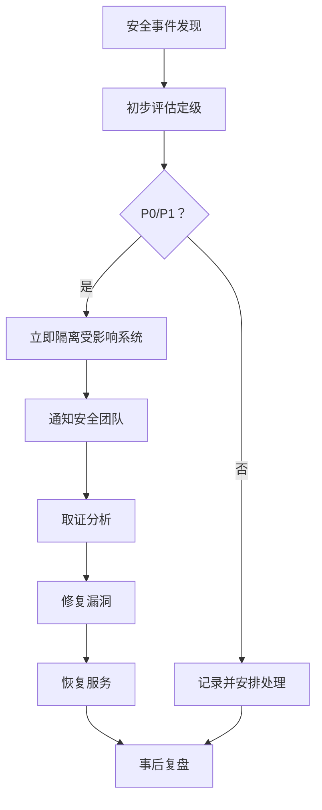

---

## 13. 安全最佳实践

### 13.1 开发阶段

- [ ] 代码审查必须包含安全检查
- [ ] 使用参数化查询，禁止拼接 SQL
- [ ] 敏感数据禁止硬编码
- [ ] 依赖库定期更新

### 13.2 部署阶段

- [ ] 启用 HTTPS
- [ ] 配置 WAF 防护
- [ ] 密钥通过环境变量注入
- [ ] 禁用不必要的端口

### 13.3 运维阶段

- [ ] 定期备份数据和密钥
- [ ] 监控异常登录行为
- [ ] 定期审查权限配置
- [ ] 日志集中收集分析

### 13.4 紧急联系方式

| 角色 | 联系方式 | 职责 |
|------|----------|------|
| 安全负责人 | security@lingsql.com | 安全决策 |
| 运维值班 | oncall@lingsql.com | 应急处置 |
| 管理层 | management@lingsql.com | 重大事件上报 |

---

## 文档变更历史

| 版本 | 日期 | 作者 | 变更说明 |
|------|------|------|----------|
| v1.0 | 2026-01-29 | LingSQL Team | 初始版本 |

---

> **安全声明**：本文档描述的安全机制需要正确配置才能生效。请确保所有安全配置项已按要求设置，并定期进行安全审计。
