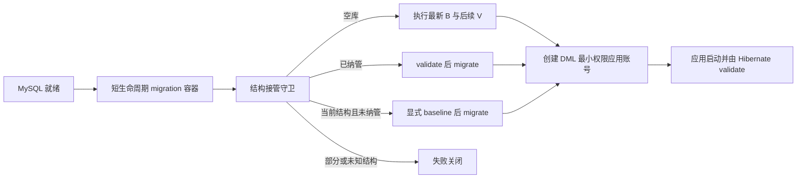

# LingSQL 数据库版本迁移与旧库接管手册

> 版本：v1.0
> 更新日期：2026-08-15
> 适用范围：LingSQL 控制库，不包含客户业务库与销售演示库

## 1. 目标与不变量

控制库结构统一由 Flyway 管理。应用进程只持有 `SELECT/INSERT/UPDATE/DELETE` 权限，DDL 凭据只进入短生命周期迁移任务。生产常态必须满足：

- `baselineOnMigrate=false`，禁止自动接管任意非空数据库。
- `validateMigrationNaming=true`、`validateOnMigrate=true`、`outOfOrder=false`、`cleanDisabled=true`。
- Hibernate 在 dev/prod 均使用 `ddl-auto=validate`，不得绕过迁移链改表。
- 已发布的 `B`/`V` 文件不可修改、重命名或删除；后续结构变化只新增更高版本 `V` 文件。
- 种子数据、管理员开户、租户 provisioning、演示业务库不属于控制库结构迁移。

当前合并起点为 `B20260815_02__lingsql_control_schema.sql`。它冻结了 Spring Boot 4 / Hibernate 7 整数类型对齐后的 36 张控制库表；`V20260815_03` 新增审计持久投递箱；`V20260815_04` 增加 SQL 请求关联字段并将计费幂等键收敛到租户作用域；`V20260815_05` 新增逐物理模型调用资金状态表及账本调用关联字段；`V20260815_06` 持久化模型真实调用验证状态；`V20260815_07` 新增 UNKNOWN 物理调用的不可变资金裁决记录；`V20260815_08` 新增计费验收会话基线与不可变回执。全部迁移完成后共 41 张控制库表。历史 `sql/patch_*.sql` 与 `db/manual` 存在重复和被修改记录，只作为交付档案，禁止加入 Flyway 扫描目录。

## 2. 迁移执行模型



标准 Compose 环境执行：

```bash
bash scripts/ops/flyway_migrate.sh
```

`bootstrap_local_stack.sh` 已内置上述步骤，顺序固定为 MySQL 就绪、Flyway 迁移、应用账号权限收敛、显式种子与演示库、应用启动。

## 3. 数据库状态判定

`schema_adoption_guard.sh` 只输出四类结果中的前三类，未知状态直接非零退出：

| 状态 | 判定 | 动作 |
| --- | --- | --- |
| `EMPTY` | 没有 LingSQL 控制表且没有历史表 | 直接 `migrate` |
| `MANAGED` | 存在 `flyway_schema_history` | `validate` 后 `migrate` |
| `CURRENT` | 无历史表，但完整指纹等于冻结基线 | 显式 baseline 到 `20260815.02` 后 `migrate` |
| 拒绝 | 缺表、多表、字段/默认值/生成表达式/索引/排序规则不一致 | 备份、收敛、复核，不写 baseline |

完整指纹覆盖：表名、存储引擎、表排序规则、表注释；字段顺序、类型、可空性、默认值、额外属性、生成表达式、字符集、排序规则和注释；索引名称、唯一性、列顺序、前缀、类型、排序与表达式。非 LingSQL 前缀的同库对象不参与比对，但不建议在控制库混放业务表。

## 4. 新环境安装

1. 创建独立空控制库并完成备份策略配置。
2. 使用迁移任务的 DDL 身份执行 `flyway_migrate.sh`。
3. 再创建或轮换应用 DML 身份，并验证权限只有四项。
4. 启动应用，确认 readiness 与 Hibernate schema validate 通过。
5. 第二次执行迁移，必须无待执行变更且校验成功。

禁止先手工导入 `sql/mysql.sql` 再把库当作新库；如果已经导入，它会被视为未纳管现有库并接受完整指纹校验。

## 5. 现有库接管

接管前必须冻结写入、完成可恢复备份，并记录应用版本、数据库版本和变更单号。执行：

```bash
bash scripts/ops/schema_adoption_guard.sh
bash scripts/ops/flyway_migrate.sh
```

只有 `CURRENT` 才允许脚本写入 baseline marker。部分升级库、历史补丁顺序不明的库、Boot 4 整数对齐未完成的库都不会被自动修复。处理流程是：

1. 在隔离副本上根据结构差异编写一次性、可审阅的收敛脚本。
2. 完成备份恢复演练，并验证收敛脚本对该客户副本的影响与耗时。
3. 维护窗口执行收敛，重新运行完整指纹守卫。
4. 指纹变为 `CURRENT` 后才执行显式 baseline 和 migrate。
5. 保存迁移输出、结构指纹结果、备份校验和及验收记录。

不得按文件名盲跑 `db/manual` 或 `sql/patch_*`，也不得通过 `baselineOnMigrate=true` 绕过结构核验。

## 6. 新增迁移规则

- 后续版本必须高于 `20260815.08`，格式示例：`V20260816_01__add_agent_registry.sql`。
- `V20260815_03__durable_audit_delivery.sql` 是合并基线后的首个正式增量版本，新增审计事件幂等键与持久投递箱。
- `V20260815_04__billing_source_of_truth.sql` 增加 SQL 日志 `request_id`，调整计费账本租户级幂等唯一键，并增加请求证据查询索引。
- `V20260815_05__physical_model_invocation_billing.sql` 新增物理模型调用资金状态表，并为账本增加不可变事件、物理调用和工作流请求关联字段。
- `V20260815_06__model_probe_readiness.sql` 为模型配置增加最近验证状态、时间、耗时和归一化错误码；模型配置变更后必须重新验证。
- `V20260815_07__physical_billing_resolution.sql` 新增唯一、不可变的资金裁决记录；只有持有供应商请求 ID 与外部证据 SHA-256 的系统管理员，才能将 UNKNOWN 调用原子收口为 SETTLED 或 CANCELLED。
- `V20260815_08__billing_acceptance_receipt.sql` 新增不可变验收会话基线和完成回执；会话冻结 MySQL 租户余额与账本水位，关闭时只接受精确请求集合、全区间 APPLIED 账本事件和终态物理调用，并验证余额变化等于区间净扣款。
- 一个版本只承载一个内聚主题；大表变更必须先做容量与锁等待评估。
- 优先采用 expand/contract：先新增兼容结构，双读或回填，后续版本再删除旧结构。
- 迁移必须兼容上一稳定应用版本，确保应用二进制回滚后仍能运行。
- MySQL 多条 DDL 不是整体事务。中途失败后先核验真实结构和 Flyway 历史，再决定补偿迁移；禁止无依据执行 `repair`。
- `DROP`、不可逆数据转换、全表重写必须单独变更单、维护窗口、备份恢复演练和负责人批准。

## 7. CI 与发布门禁

CI 的 `Database Migration` 作业在 MySQL 8.4 上验证：

- 空库执行合并基线成功。
- 第二次迁移无重复执行。
- 41 张控制表存在且历史无失败记录，最新成功版本为 `20260815.08`。
- 手工导入当前合并结构的未纳管库，可通过完整指纹并显式接管。

正式发布工作流要求 self-hosted 环境配置可执行的 `LINGSQL_MIGRATION_HOOK`。Hook 必须完成目标库备份、校验、迁移与结果留档，退出非零会阻止应用发布。数据库迁移发生在蓝绿制品切换前；后续应用冒烟失败时只自动回滚应用，不自动反向执行数据库 DDL。

## 8. 故障处置与回滚边界

1. 迁移失败立即停止应用发布，保留日志，不重复尝试未知 DDL。
2. 查询 `flyway_schema_history` 与 `information_schema`，确认哪些语句已生效。
3. 若迁移是向前兼容的，优先修正脚本并发布更高版本补偿迁移。
4. 只有经过演练且业务确认需要恢复时，才从已校验备份恢复整个目标库。
5. 禁止让应用回滚脚本删除 Flyway 历史或自动执行反向 DDL。

这套边界意味着“应用可自动回滚”不等于“数据库可自动回滚”。生产发布必须以向前兼容迁移和可验证备份作为前提。
